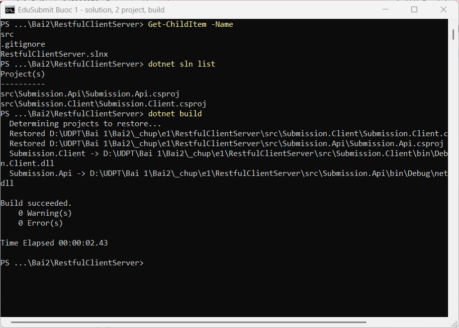
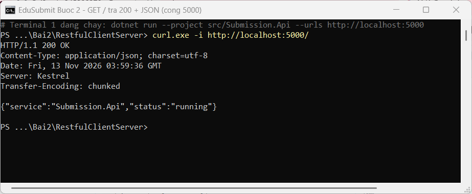
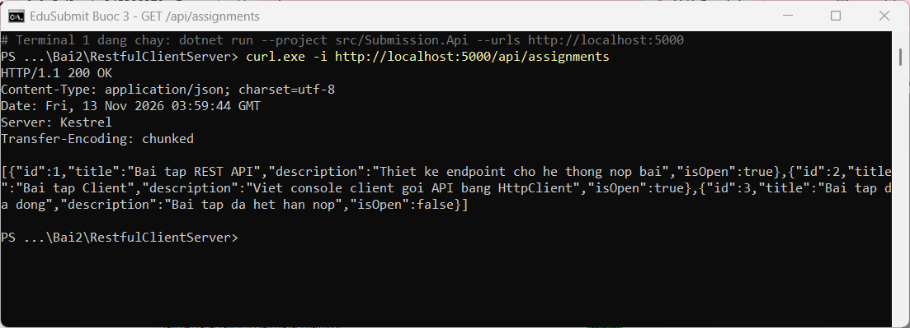
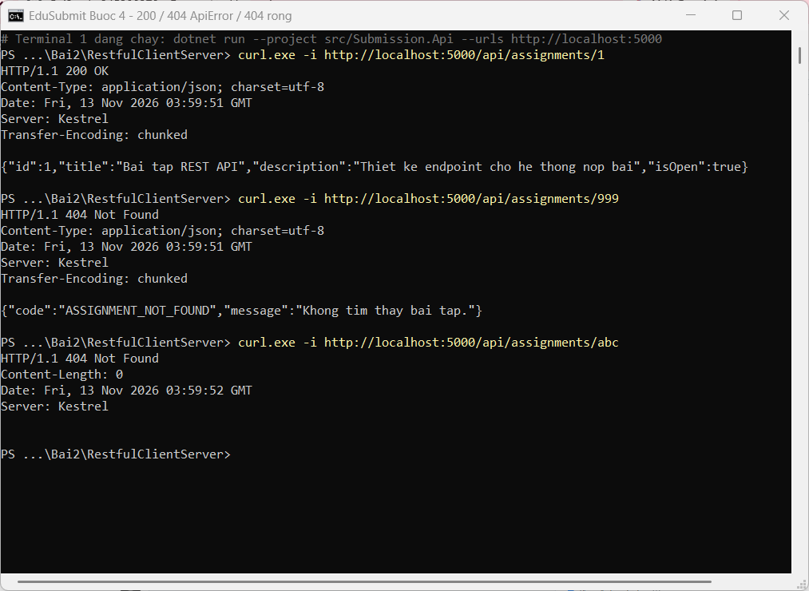
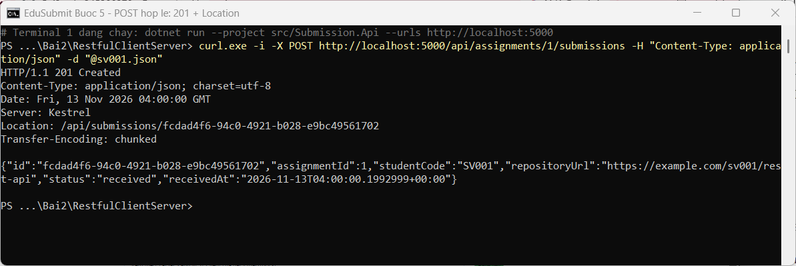
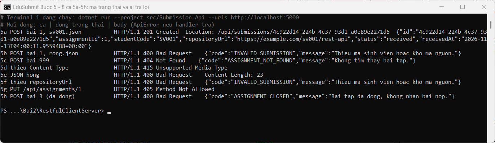
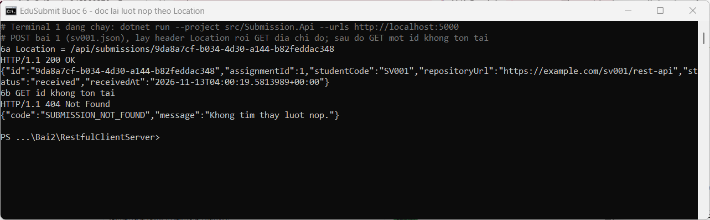
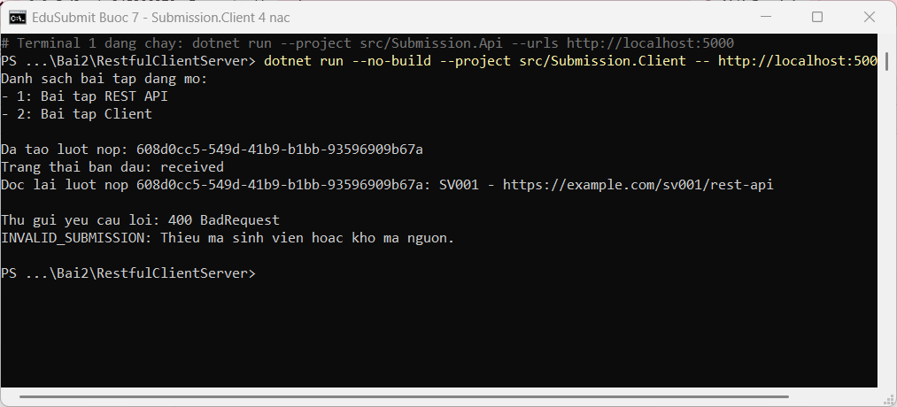
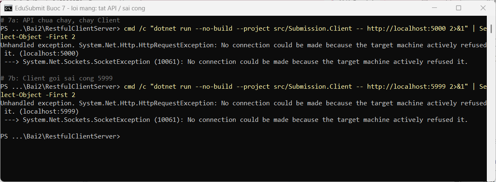
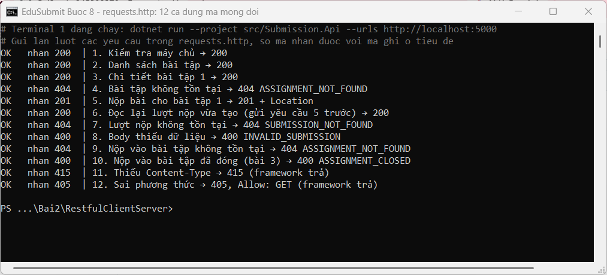

# EduSubmit (Bài 2, Phần 3): RestfulClientServer

Sinh viên: Dương Ngô Hùng, MSSV dtc245200279.

Hệ phân tán thu nhỏ gồm hai chương trình, hai tiến trình, nói chuyện qua một hợp đồng HTTP + JSON:

- `src/Submission.Api`: máy chủ Minimal API, cổng 5000, giữ bài tập và lượt nộp trong bộ nhớ.
- `src/Submission.Client`: máy khách console, chuỗi 4 nấc: liệt kê → nộp → đọc lại → cố ý gửi sai.

## Cách chạy

```powershell
# Terminal 1: máy chủ
dotnet run --project src/Submission.Api --urls http://localhost:5000

# Terminal 2: máy khách (sau dấu -- là địa chỉ API, vào args[0])
dotnet run --project src/Submission.Client -- http://localhost:5000
```

Ca kiểm thử: `requests.http` (REST Client, 12 yêu cầu) và các tệp body cho `curl.exe -d "@tep.json"`: `sv001.json`, `rong.json`, `thieu-truong.json`, `hong.json`.

## Hợp đồng API

| Phương thức | URI | Thành công | Lỗi |
|---|---|---|---|
| GET | `/` | 200 `{service, status}` | – |
| GET | `/api/assignments` | 200 danh sách | – |
| GET | `/api/assignments/{assignmentId:int}` | 200 một bài tập | 404 `ASSIGNMENT_NOT_FOUND` |
| POST | `/api/assignments/{assignmentId:int}/submissions` | 201 + `Location` + `SubmissionDto` | 404 `ASSIGNMENT_NOT_FOUND` · 400 `ASSIGNMENT_CLOSED` · 400 `INVALID_SUBMISSION` |
| GET | `/api/submissions/{submissionId:guid}` | 200 lượt nộp | 404 `SUBMISSION_NOT_FOUND` |

Mọi lỗi do handler trả có cùng dạng `ApiError { code, message }`. Dữ liệu mẫu có 3 bài tập: 1 và 2 đang mở, 3 đã đóng (để thử `ASSIGNMENT_CLOSED`).

## Nhật ký từng bước

Mỗi bước là một commit; ảnh được chụp khi chạy đúng mã nguồn của commit đó.

### Bước 1: dựng solution, hai project, `.gitignore`

```powershell
dotnet new sln -n RestfulClientServer
dotnet new web -n Submission.Api -o src/Submission.Api
dotnet new console -n Submission.Client -o src/Submission.Client
dotnet sln add src/Submission.Api/Submission.Api.csproj
dotnet sln add src/Submission.Client/Submission.Client.csproj
dotnet new gitignore
dotnet build
```



### Bước 2: chạy máy chủ ở cổng 5000, `GET /`



### Bước 3: DTO, dữ liệu mẫu, `GET /api/assignments`

`IsOpen` trong C# thành `isOpen` trong JSON (camelCase).



### Bước 4: `GET /api/assignments/{assignmentId:int}`

`/999` do handler trả 404 có `ApiError`; `/abc` không khớp ràng buộc `:int` nên framework trả 404 rỗng, handler không chạy.



### Bước 5: `POST /api/assignments/{assignmentId}/submissions` qua 3 cổng kiểm tra

Thứ tự: bài tập tồn tại? → còn mở? → body hợp lệ? → máy chủ tự sinh `Id` (Guid), `Status = "received"`, `ReceivedAt`, lưu và trả 201 + `Location`.





### Bước 6: đọc lại lượt nộp theo `Location`



### Bước 7: máy khách 4 nấc

Máy khách xem `StatusCode` trước rồi mới chọn kiểu đọc body (`SubmissionDto` hay `ApiError`); đọc lại theo đúng URI trong header `Location` bằng `GetAsync` (không dùng `GetFromJsonAsync` cho yêu cầu có thể trả 404). Mọi lỗi in qua một hàm `PrintApiErrorAsync`.



Lỗi mạng khác lỗi HTTP: khi API chưa chạy hoặc sai cổng, không có phản hồi nào, chỉ có `HttpRequestException: connection refused`.



### Bước 8: `requests.http`

12 yêu cầu, phủ đủ 200, 201, 400, 404, 405, 415. Yêu cầu 6 lấy `id` từ phản hồi của yêu cầu 5 (`# @name createSubmission`).



## Bảng phá thử (8 ca ở Bước 5)

| Ca | Yêu cầu | Kết quả thật | Ai trả | Ý nghĩa |
|---|---|---|---|---|
| 5a | POST bài 1, `sv001.json` | 201 + `Location` | Handler | Tạo thành công, có địa chỉ đọc lại |
| 5b | POST bài 1, `rong.json` | 400 `INVALID_SUBMISSION` | Handler | Body thiếu dữ liệu |
| 5c | POST bài 999 | 404 `ASSIGNMENT_NOT_FOUND` | Handler | Tài nguyên cha không tồn tại |
| 5d | Bỏ `Content-Type` | 415, body rỗng | Framework | Không biết body là JSON, handler không chạy |
| 5e | JSON hỏng (`hong.json`) | 400, không có `ApiError` | Framework | Không đọc được body |
| 5f | Thiếu `repositoryUrl` | 400 `INVALID_SUBMISSION` | Handler | Trường thiếu thành null, handler bắt được |
| 5g | `PUT /api/assignments/1` | 405 | Framework | URI có, phương thức không hỗ trợ |
| 5h | POST bài 3 (đã đóng) | 400 `ASSIGNMENT_CLOSED` | Handler | Đúng cú pháp, sai quy tắc nghiệp vụ |

## Ba câu hỏi giải thích

**1. Vì sao URI dùng danh từ, còn hành động do phương thức HTTP đảm nhận?**

URI là tên của tài nguyên (bài tập, lượt nộp), còn việc làm gì với tài nguyên đã có sẵn trong phương thức: GET đọc, POST tạo. Tách như vậy thì cùng một URI dùng được cho nhiều thao tác và máy khách đoán được cách dùng chỉ từ URI + phương thức + mã trạng thái. Ví dụ trong code: `POST /api/assignments/1/submissions` nghĩa là "tạo một lượt nộp thuộc bài tập 1", thay cho kiểu gọi hàm `POST /submitAssignment`; và `GET /api/submissions/{id}` đọc lại đúng lượt nộp đó.

**2. "Stateless" thể hiện ở đâu trong code đã viết?**

Mỗi yêu cầu tự mang đủ thông tin để xử lý: `assignmentId` nằm trên URI, `studentCode` và `repositoryUrl` nằm trong body (`CreateSubmissionRequest`). Handler không đọc biến phiên nào kiểu "bài tập đang chọn" từ yêu cầu trước. Máy khách đọc lại lượt nộp bằng đúng URI trong `Location`, không dựa vào việc máy chủ nhớ mình vừa nộp gì. Máy chủ vẫn lưu dữ liệu nghiệp vụ (`List<SubmissionDto>`), stateless chỉ có nghĩa là không nhớ cuộc hội thoại giữa hai yêu cầu.

**3. Vì sao client và server mỗi bên khai báo DTO riêng mà vẫn khớp nhau?**

Hai bên là hai chương trình riêng, không tham chiếu project của nhau; thứ đi qua mạng là JSON chứ không phải đối tượng C#. `SubmissionDto` ở máy khách là bản sao của hợp đồng: chỉ cần tên trường và kiểu dữ liệu khớp với JSON (`id`, `assignmentId`, `studentCode`, ... — `System.Text.Json` so tên không phân biệt hoa thường) là đọc được. Trình biên dịch không kiểm tra được điều này: đặt sai tên trường thì vẫn build được nhưng giá trị nhận về là null.
