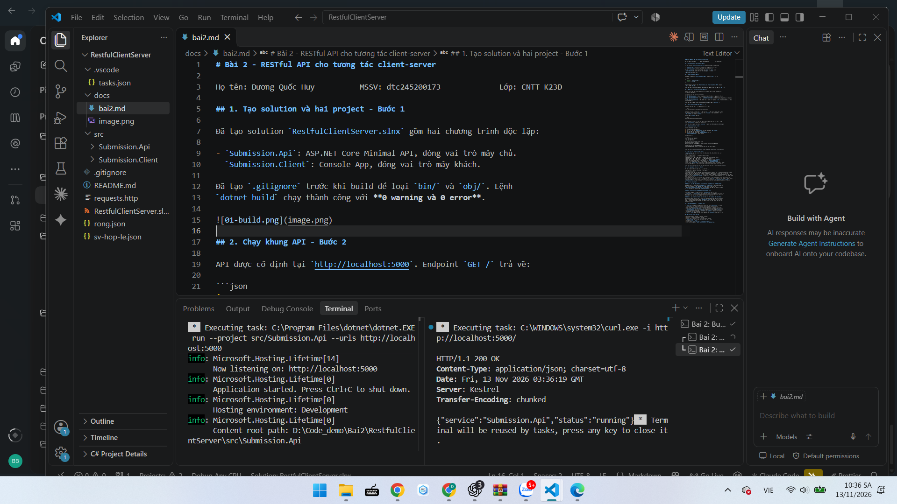
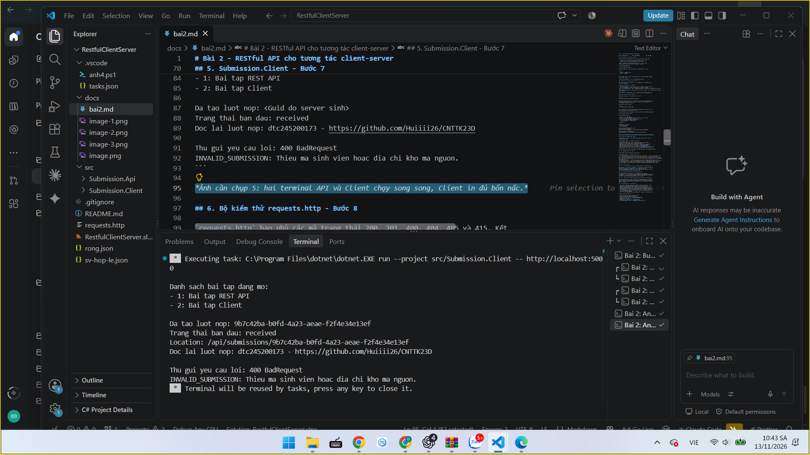

# Bài 2 - RESTful API cho tương tác client-server

- Sinh viên: Nguyễn Thị Lam
- Mã sinh viên: dtc245200411
- Lớp: CNTT K23D
- Công nghệ: .NET 10, ASP.NET Core Minimal API, `HttpClient`

## 1. Cấu trúc bài làm

```text
RestfulClientServer/
|- RestfulClientServer.slnx
|- requests.http
|- sv-hop-le.json
|- rong.json
|- src/
   |- Submission.Api/
   `- Submission.Client/
```

`Submission.Api` giữ dữ liệu bài tập và lượt nộp trong bộ nhớ. `Submission.Client`
là chương trình console độc lập, chỉ giao tiếp với API qua HTTP và JSON.

## 2. Hợp đồng API

| Phương thức | URI | Thành công | Lỗi do handler trả |
|---|---|---|---|
| GET | `/` | 200 + trạng thái dịch vụ | - |
| GET | `/api/assignments` | 200 + danh sách | - |
| GET | `/api/assignments/{assignmentId}` | 200 + bài tập | 404 `ASSIGNMENT_NOT_FOUND` |
| POST | `/api/assignments/{assignmentId}/submissions` | 201 + `Location` + lượt nộp | 404 `ASSIGNMENT_NOT_FOUND`; 400 `ASSIGNMENT_CLOSED`; 400 `INVALID_SUBMISSION` |
| GET | `/api/submissions/{submissionId}` | 200 + lượt nộp | 404 `SUBMISSION_NOT_FOUND` |

Mọi lỗi do handler trả có cùng dạng:

```json
{
  "code": "ERROR_CODE",
  "message": "Mô tả lỗi"
}
```

## 3. Lệnh build và chạy

Tại thư mục `Bai2`:

```powershell
dotnet build
dotnet run --project src/Submission.Api --urls http://localhost:5000
```

Mở terminal thứ hai để chạy Client:

```powershell
dotnet run --project src/Submission.Client -- http://localhost:5000
```

Có thể mở `requests.http` bằng extension REST Client và bấm **Send Request**
cho từng ca kiểm thử.

## 4. Kết quả tự kiểm tra

| Ca | Yêu cầu | Kết quả mong đợi |
|---|---|---|
| 1 | `GET /` | 200 |
| 2 | `GET /api/assignments` | 200, ba bài tập mẫu |
| 3 | `GET /api/assignments/1` | 200 |
| 4 | `GET /api/assignments/999` | 404 + `ASSIGNMENT_NOT_FOUND` |
| 5a | POST bài 1, dữ liệu hợp lệ | 201 + `Location` |
| 5b | POST bài 1, dữ liệu rỗng | 400 + `INVALID_SUBMISSION` |
| 5c | POST bài 999 | 404 + `ASSIGNMENT_NOT_FOUND` |
| 5d | POST thiếu `Content-Type` | 415 do framework trả |
| 5e | POST JSON hỏng | 400 do framework trả |
| 5f | POST thiếu `repositoryUrl` | 400 + `INVALID_SUBMISSION` |
| 5g | `PUT /api/assignments/1` | 405, `Allow: GET` |
| 5h | POST bài 3 đã đóng | 400 + `ASSIGNMENT_CLOSED` |
| 6a | GET theo `Location` vừa tạo | 200 + đúng lượt nộp |
| 6b | GET một Guid không tồn tại | 404 + `SUBMISSION_NOT_FOUND` |

Kết quả chạy lại: solution build với 0 cảnh báo và 0 lỗi. Client liệt kê hai bài
tập đang mở, tạo lượt nộp trạng thái `received`, đọc lại theo `Location` đúng
MSSV `dtc245200411` và in `400 BadRequest` / `INVALID_SUBMISSION` ở ca gửi sai.

## 5. Bảng thí nghiệm hệ phân tán

Đã kiểm thử trên máy vào ngày 15/11/2026. Dùng cổng `15141` cho API và cổng
`15999` cho ca sai cổng để tránh xung đột với tiến trình khác.

| Thí nghiệm | Kết quả thực tế | Giải thích |
|---|---|---|
| Chạy Client lần hai khi API vẫn chạy | Danh sách bài tập giữ nguyên, tạo thêm một lượt nộp có Guid mới | Trạng thái nằm trong bộ nhớ tiến trình API, không nằm ở Client. |
| Tắt API rồi chạy Client | Client báo không kết nối được, không nhận phản hồi HTTP | Tiến trình ở xa có thể vắng mặt; đây là lỗi mạng, khác lỗi HTTP 4xx. |
| Chạy lại API | GET theo Location của lượt nộp cũ trả `404 SUBMISSION_NOT_FOUND` | Dữ liệu chỉ lưu trong `List`, nên mất khi tiến trình API dừng. |
| Chạy Client với cổng 15999 | Client báo kết nối bị từ chối | Hai bên phải thống nhất địa chỉ dịch vụ. URL là cấu hình của Client. |

## 6. Trả lời ba câu hỏi

### 6.1. Vì sao URI dùng danh từ, còn hành động do phương thức HTTP đảm nhận?

URI dùng để định danh tài nguyên, ví dụ `assignments` và `submissions`. Hành động
được thể hiện bằng phương thức HTTP: `GET` để đọc và `POST` để tạo. Vì vậy
`POST /api/assignments/1/submissions` rõ nghĩa hơn `/submitAssignment`: URI cho
biết đang làm việc với lượt nộp thuộc bài tập 1, còn `POST` cho biết hành động tạo.

### 6.2. “Stateless” thể hiện ở đâu trong code đã viết?

Mỗi yêu cầu tự chứa đủ thông tin để API xử lý. `assignmentId` nằm trên URI;
`studentCode` và `repositoryUrl` nằm trong body. API không cần nhớ Client đã gọi
yêu cầu nào trước đó hoặc giữ một phiên hội thoại. Stateless không có nghĩa API
không lưu dữ liệu: danh sách bài tập và lượt nộp vẫn được lưu trong bộ nhớ của API.

### 6.3. Vì sao Client và Server khai báo DTO riêng mà vẫn khớp nhau?

DTO là hợp đồng JSON ở biên hệ thống, không phải lớp C# dùng chung. Hai chương
trình độc lập vẫn khớp vì tên thuộc tính và kiểu dữ liệu tương ứng trong JSON giống
nhau. Cách này giúp Client không cần tham chiếu project của Server và hai bên có
thể thay đổi phần triển khai nội bộ mà không phá vỡ hợp đồng API.

## 7. Ảnh minh họa cách chạy

Ảnh dưới đây minh họa thao tác trên bản mẫu Bài 2 của Dương Quốc Huy.
Kết quả chạy lại với MSSV của Lam được ghi ở mục 4 và 5.





## 8. Kiểm tra trước khi nộp

- `dotnet build` phải đạt 0 lỗi.
- Không nộp các thư mục `bin/`, `obj/`.
- Chỉ đưa bài vào `Nguyễn Thị Lam - dtc245200411/Bai2`.
- Tiêu đề Pull Request: `Bai2 - dtc245200411 - Nguyễn Thị Lam`.
