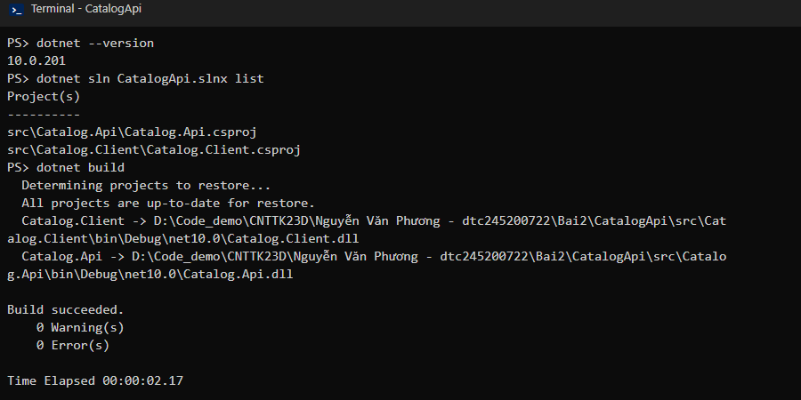
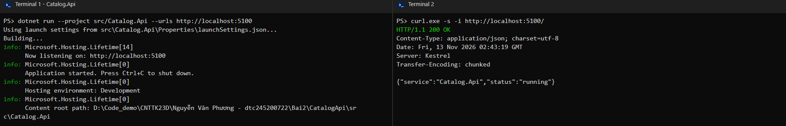
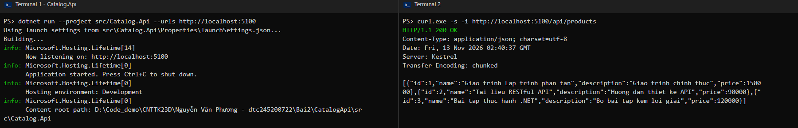
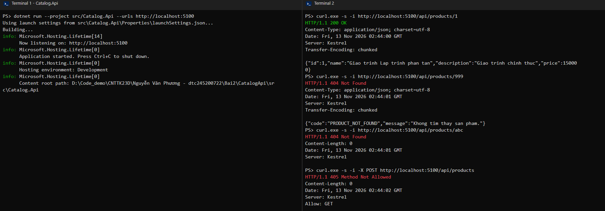
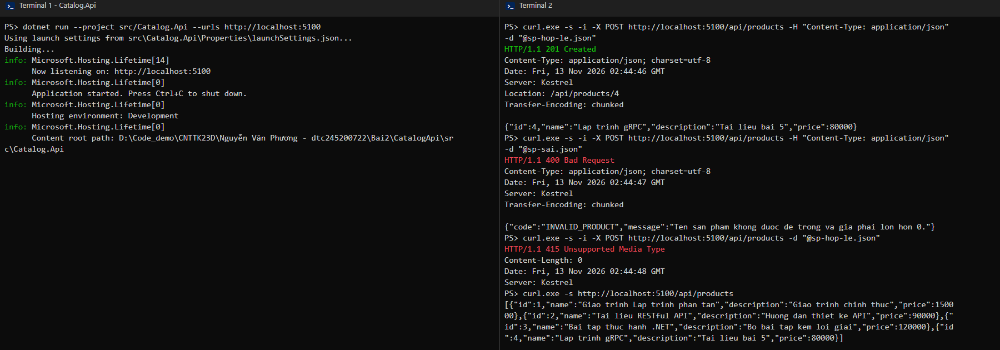
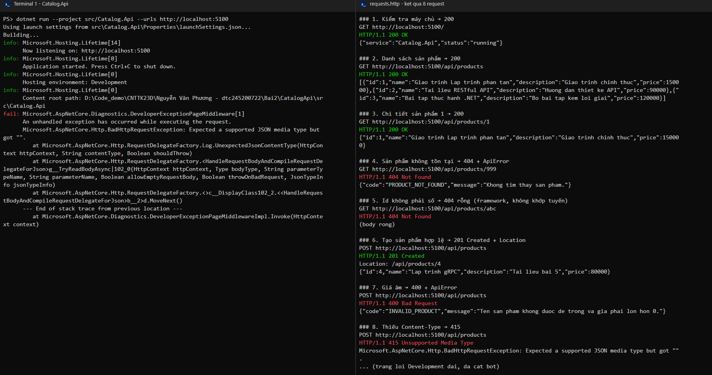
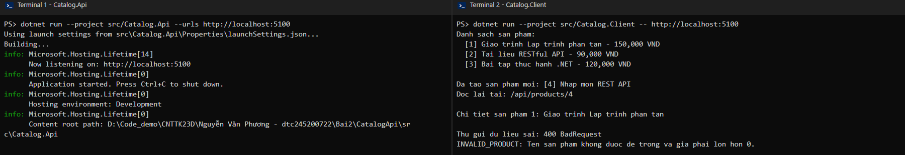
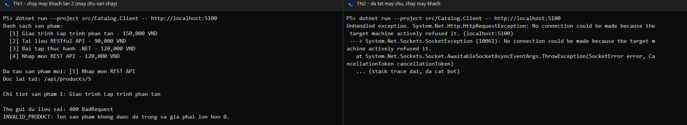
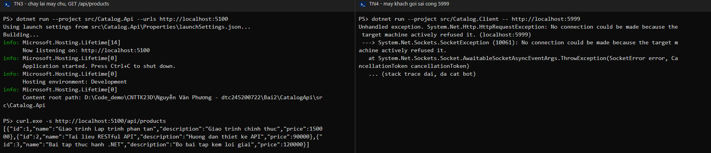

# Bài 2 – RESTful API cho tương tác client–server

Họ tên: Nguyễn Văn Phương     MSSV: DTC245200722     Lớp: CNTT K23D

Cấu trúc thư mục:

```text
Bai2/
├── CatalogApi/                 # Phần 2: Catalog API (10 bước)
│   ├── CatalogApi.slnx
│   ├── requests.http
│   ├── sp-hop-le.json, sp-sai.json
│   └── src/
│       ├── Catalog.Api/        # máy chủ, cổng 5100
│       └── Catalog.Client/     # máy khách
└── docs/
    ├── bai2.md                 # nhật ký này
    └── img/
```

Ảnh trong nhật ký được tạo từ kết quả chạy thật của từng lệnh (Terminal 1: máy chủ, Terminal 2: lệnh gọi / máy khách).

## 1. Tạo solution và 2 project (Bước 1)

- .NET SDK: `10.0.201`
- Solution `CatalogApi.slnx` gồm `Catalog.Api` (web) và `Catalog.Client` (console), có `.gitignore` để bỏ qua `bin/`, `obj/`.



## 2. Chạy khung API (Bước 2)

Sửa endpoint `/` để trả JSON, chạy máy chủ ở cổng 5100:

```bash
dotnet run --project src/Catalog.Api --urls http://localhost:5100
```



- `Results.Ok(new { service, status })` trả **200 OK** kèm JSON; tên thuộc tính tự đổi sang camelCase.
- Phải ép cổng bằng `--urls`, nếu không mẫu dùng cổng trong `launchSettings.json` (5197) và máy khách không biết gọi đâu.

## 3. DTO và GET danh sách (Bước 3)

- Khai báo `record ProductDto(int Id, string Name, string Description, decimal Price)` và `record ApiError(string Code, string Message)` ở **cuối** `Program.cs` (sau `app.Run()`), vì câu lệnh cấp cao nhất phải đứng trước khai báo kiểu.
- Dữ liệu mẫu là `List<ProductDto>` 3 sản phẩm, nằm trong bộ nhớ tiến trình máy chủ.



## 4. GET chi tiết (Bước 4)

`GET /api/products/{id:int}`: tìm thấy thì 200, không thấy thì 404 + `ApiError`.



| Lệnh | Kết quả thật | Ai trả lời |
|------|--------------|------------|
| `GET /api/products/1` | 200 OK + sản phẩm 1 | Handler: tìm thấy |
| `GET /api/products/999` | 404 + `{"code":"PRODUCT_NOT_FOUND",...}` | Handler: chạy nhưng không tìm thấy |
| `GET /api/products/abc` | 404, `Content-Length: 0` | Framework: `abc` không khớp `{id:int}`, handler không chạy |
| `POST /api/products` | 405 Method Not Allowed, `Allow: GET` | Framework: URI có nhưng chưa có POST |

Cả `/999` và `/abc` đều 404; máy khách phân biệt bằng **body**: có `ApiError` là handler trả, body rỗng là sai đường dẫn.

## 5. POST tạo mới (Bước 5)

- DTO đầu vào `CreateProductRequest(string Name, string? Description, decimal Price)` **không có Id**: Id do máy chủ sinh (`Max + 1`).
- Kiểm tra ở biên hệ thống: tên rỗng hoặc giá ≤ 0 → 400 `INVALID_PRODUCT`.
- Thành công → `Results.Created($"/api/products/{id}", product)`: 201 + header `Location`.



| Ca | Kết quả thật | Ai từ chối |
|----|--------------|------------|
| ① Hợp lệ (`sp-hop-le.json`) | 201 Created, `Location: /api/products/4` | – (handler tạo) |
| ② Giá âm (`sp-sai.json`) | 400 + `INVALID_PRODUCT` | Handler (khối `if`) |
| ③ Thiếu `Content-Type` | 415 Unsupported Media Type | Framework, chặn trước handler |

Sau ca ①, `GET /api/products` có 4 sản phẩm.

Ghi chú: với `curl.exe -d` không có `-H`, curl tự gắn `Content-Type: application/x-www-form-urlencoded` nên 415 trả về body rỗng; khi gửi không có Content-Type (ca 8 trong `requests.http`) thì chế độ Development trả trang lỗi dài.

## 6. requests.http (Bước 6)

Tệp `CatalogApi/requests.http` có 8 yêu cầu, tiêu đề ghi mã mong đợi. Kết quả gửi lần lượt 8 yêu cầu (máy chủ vừa khởi động lại):



| # | Request | Mong đợi | Thực tế |
|---|---------|----------|---------|
| 1 | `GET /` | 200 | 200 |
| 2 | `GET /api/products` | 200 | 200, 3 phần tử |
| 3 | `GET /api/products/1` | 200 | 200 |
| 4 | `GET /api/products/999` | 404 + ApiError | 404 + `PRODUCT_NOT_FOUND` |
| 5 | `GET /api/products/abc` | 404 rỗng | 404 rỗng |
| 6 | `POST` hợp lệ | 201 + Location | 201, `Location: /api/products/4` |
| 7 | `POST` giá âm | 400 + ApiError | 400 + `INVALID_PRODUCT` |
| 8 | `POST` thiếu Content-Type | 415 | 415 |

## 7. Máy khách Catalog.Client (Bước 7–8)

Chạy (máy chủ chạy ở Terminal 1):

```bash
dotnet run --project src/Catalog.Client -- http://localhost:5100
```



Kết quả máy khách:

```text
Danh sach san pham:
  [1] Giao trinh Lap trinh phan tan - 150,000 VND
  [2] Tai lieu RESTful API - 90,000 VND
  [3] Bai tap thuc hanh .NET - 120,000 VND

Da tao san pham moi: [4] Nhap mon REST API
Doc lai tai: /api/products/4

Chi tiet san pham 1: Giao trinh Lap trinh phan tan

Thu gui du lieu sai: 400 BadRequest
INVALID_PRODUCT: Ten san pham khong duoc de trong va gia phai lon hon 0.
```

1. Nấc 1: `GetFromJsonAsync<List<ProductDto>>` gửi GET và đổi JSON thành danh sách.
2. Nấc 2: `PostAsJsonAsync` trả về cả phản hồi; máy khách **kiểm tra `StatusCode == Created` trước**, rồi mới chọn đọc body là `ProductDto` (201) hay `ApiError` (mã khác). Header `Location` cho biết đọc lại ở đâu.
3. Nấc 3: `GetFromJsonAsync<ProductDto>("/api/products/1")` – chỉ dùng khi chắc chắn tồn tại, vì hàm này ném exception nếu mã không phải 2xx.
4. Nấc 4: cố ý gửi tên rỗng, giá âm; máy khách đọc được 400 và in `Code: Message` thay vì sập.
5. Máy khách khai báo **lại** `ProductDto`, `CreateProductRequest`, `ApiError`: hai chương trình không chung code, chỉ chung hợp đồng JSON (tên trường, kiểu dữ liệu).

## 8. Thí nghiệm phân tán (Bước 9)

| # | Thí nghiệm | Kết quả thật | Bài học |
|---|------------|--------------|---------|
| 1 | Chạy máy khách lần 2 (máy chủ vẫn chạy) | Danh sách có 4 sản phẩm, tạo mới ra `[5]`, `Doc lai tai: /api/products/5` | Trạng thái nằm ở máy chủ, không ở máy khách |
| 2 | Tắt máy chủ, chạy máy khách | `Unhandled exception. HttpRequestException: No connection could be made because the target machine actively refused it. (localhost:5100)` | Lỗi chỉ có ở hệ phân tán: bên kia có thể vắng mặt |
| 3 | Chạy lại máy chủ rồi `GET /api/products` | Lại chỉ còn 3 sản phẩm | Dữ liệu trong bộ nhớ mất khi tiến trình dừng |
| 4 | Máy khách gọi sai cổng `http://localhost:5999` | `actively refused it. (localhost:5999)` | Hai bên phải thống nhất địa chỉ (URL) |

Thí nghiệm 1 và 2:



Thí nghiệm 3 và 4:



## 9. Phiếu tự kiểm tra (Bước 10)

| # | Yêu cầu | Mong đợi | Tự đánh giá |
|---|---------|----------|-------------|
| 1 | `GET /` | 200 | ✓ |
| 2 | `GET /api/products` | 200, 3 phần tử | ✓ |
| 3 | `GET /api/products/1` | 200 | ✓ |
| 4 | `GET /api/products/999` | 404 + ApiError | ✓ |
| 5 | `GET /api/products/abc` | 404 rỗng | ✓ |
| 6 | POST hợp lệ | 201 + Location | ✓ |
| 7 | POST giá âm | 400 + ApiError | ✓ |
| 8 | POST thiếu Content-Type | 415 | ✓ |
| 9 | Máy khách chạy đủ 4 nấc | 4 nấc | ✓ |
| 10 | Tắt máy chủ, chạy máy khách | lỗi kết nối | ✓ |

Commit theo từng bước:

```text
Buoc 1: tao solution CatalogApi
Buoc 2: GET / tra JSON
Buoc 3: DTO va GET /api/products
Buoc 4: GET /api/products/{id}
Buoc 5: POST /api/products
Buoc 6: requests.http
Buoc 7-8: Catalog.Client
```

Luồng thông điệp:

```text
Client --(HTTP GET  /api/products)-------> Api : request-response (200)
Client --(HTTP POST /api/products)-------> Api : request-response (201 + Location / 400)
Client --(HTTP GET  /api/products/{id})--> Api : request-response (200 / 404)
```

## 10. EduSubmit (Phần 3 – áp dụng)

_Đang làm – sẽ bổ sung: 4 endpoint `Submission.Api` (cổng 5000), máy khách liệt kê → nộp → đọc lại → gửi sai, `requests.http`, bảng phá thử và 3 câu hỏi._

## 11. Khó khăn gặp phải và cách giải quyết

- Làm Bước 1–3 trước khi tạo repo git. Cách giải quyết: clone fork về máy, đồng bộ với repo lớp (`git pull upstream main`), chép bài vào `Bai2/` và commit lại đúng theo từng bước.
- Sửa code nhưng gọi API vẫn ra kết quả cũ (404 ở `/api/products`) vì máy chủ cũ vẫn đang chạy. Cách giải quyết: Ctrl+C ở Terminal 1 rồi chạy lại máy chủ sau mỗi lần sửa.
- `dotnet build` báo lỗi khóa tệp `Catalog.Api.exe` khi máy chủ còn chạy. Cách giải quyết: tắt máy chủ trước khi build lại.
- Có dùng trợ lý AI để hỗ trợ viết code, chạy kiểm thử và ghi nhật ký; đã đọc lại code và đối chiếu kết quả với slide.
