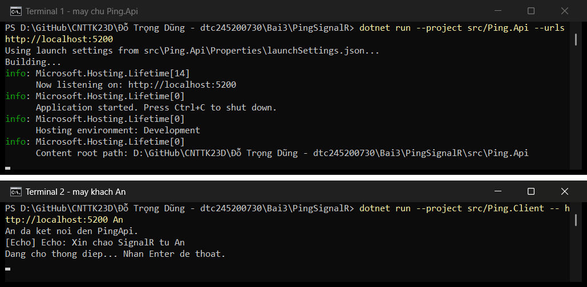
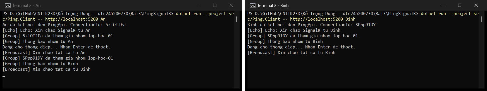
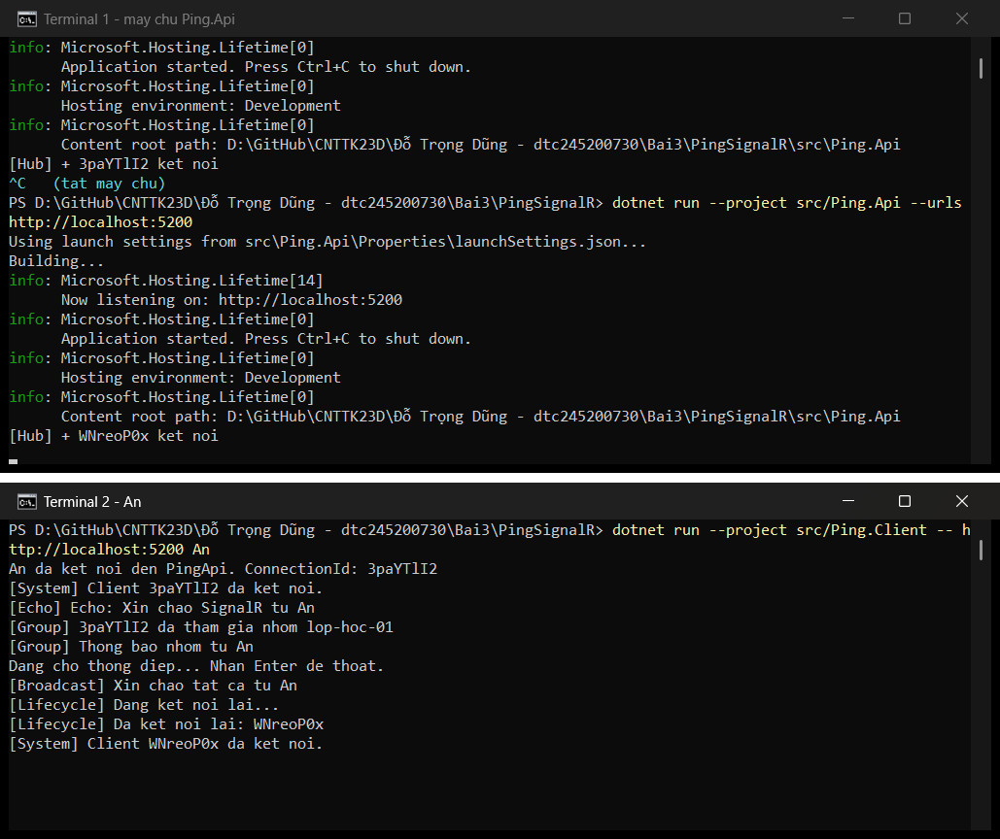
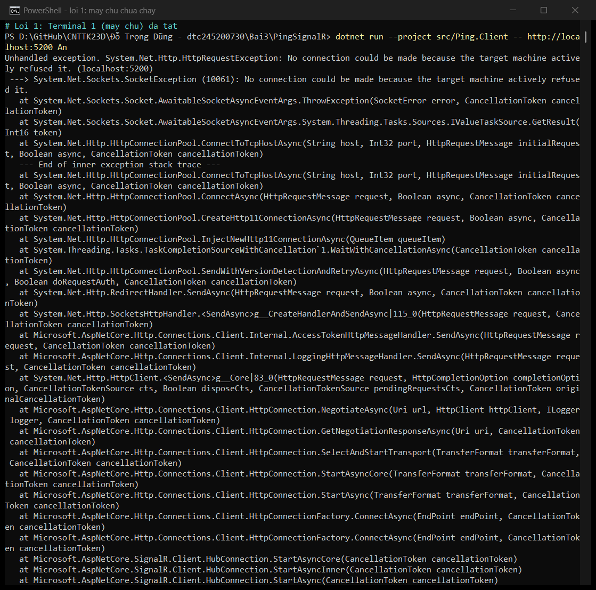

# Bài 3 – Giao tiếp thời gian thực với SignalR

Sinh viên: **Đỗ Trọng Dũng – dtc245200730**

Thư mục `Bai3` gồm hai solution:

| Solution | Project | Cổng | Vai trò |
|---|---|---|---|
| `PingSignalR` | `Ping.Api`, `Ping.Client` | 5200 | Ví dụ cơ bản: hub `/hubs/ping`, Echo / Broadcast / Group / vòng đời kết nối |
| `RealtimeSubmissionSystem` | `Submission.RealtimeApi`, `Submission.RealtimeClient` | 5000 | EduSubmit realtime: REST của Bài 2 + hub `/hubs/submissions` đẩy `processing`, `graded` |

---

## Phần 1 – PingSignalR

### Bước 1: tạo solution, 2 project, thêm gói SignalR Client


```powershell
mkdir PingSignalR; cd PingSignalR
dotnet new sln -n PingSignalR
dotnet new web -n Ping.Api -o src/Ping.Api
dotnet new console -n Ping.Client -o src/Ping.Client
dotnet sln add src/Ping.Api/Ping.Api.csproj
dotnet sln add src/Ping.Client/Ping.Client.csproj
dotnet add src/Ping.Client package Microsoft.AspNetCore.SignalR.Client --version 10.0.15
dotnet new gitignore
dotnet build
```

```text
Build succeeded.
    0 Warning(s)
    0 Error(s)
```

Thấy: build 2 project không lỗi. Giải thích: máy chủ dùng `Microsoft.AspNetCore.App` đã có sẵn SignalR, chỉ máy khách console cần thêm gói `Microsoft.AspNetCore.SignalR.Client` (cố định 10.0.15 để tránh cảnh báo bảo mật NU1903 của 10.0.0).

### Bước 2: máy chủ `AddSignalR` + `MapHub`, kiểm tra negotiate bằng curl


Terminal 1 – máy chủ:

```text
> dotnet run --project src/Ping.Api --urls http://localhost:5200
info: Microsoft.Hosting.Lifetime[14]
      Now listening on: http://localhost:5200
```

Terminal 2 – ba lệnh kiểm tra:

```text
> curl.exe http://localhost:5200/
{"service":"PingApi","status":"running"}

> curl.exe -X POST "http://localhost:5200/hubs/ping/negotiate?negotiateVersion=1"
{"negotiateVersion":1,"connectionId":"L1IIX_16Z25tC-a3QluWXw","connectionToken":"kF3ooiB7rHwyM4GEsY58ug",
 "availableTransports":[{"transport":"WebSockets","transferFormats":["Text","Binary"]},
                        {"transport":"ServerSentEvents","transferFormats":["Text"]},
                        {"transport":"LongPolling","transferFormats":["Text","Binary"]}]}

> curl.exe -i http://localhost:5200/hubs/ping
HTTP/1.1 400 Bad Request
Connection ID required
```

Thấy: negotiate trả `connectionId` và đủ 3 cơ chế truyền tải `WebSockets`, `ServerSentEvents`, `LongPolling`.
Giải thích: `AddSignalR()` đăng ký dịch vụ lõi (quản lý kết nối, nhóm, JSON hub protocol), `MapHub<PingHub>("/hubs/ping")` mở điểm cuối hub. Bước negotiate là bắt tay đầu tiên: máy chủ cấp mã kết nối và báo các cách truyền tải theo thứ tự ưu tiên. Gọi thẳng `GET /hubs/ping` bị 400 vì hub không trả lời như REST, phải có ConnectionId. Endpoint REST `GET /` vẫn chạy song song với hub.

### Bước 3: phương thức hub `Echo` trả lời riêng người gọi


```csharp
sealed class PingHub : Hub
{
    public async Task Echo(string message)
    {
        await Clients.Caller.SendAsync("EchoResponse", $"Echo: {message}");
    }
}
```

```text
> dotnet build
    0 Warning(s)
    0 Error(s)
> dotnet run --project src/Ping.Api --urls http://localhost:5200
      Now listening on: http://localhost:5200
```

Giải thích: mỗi phương thức `public` của hub là một "điểm cuối thời gian thực" mà máy khách gọi bằng `InvokeAsync("Echo", ...)`. Mẫu câu gửi `Clients.Caller.SendAsync("EchoResponse", dữ liệu)` = tập máy khách → ai nhận (`Caller` = chỉ kết nối vừa gọi) → gửi đi → TÊN thông điệp → nội dung. Hub chưa test được bằng curl vì cần máy khách SignalR, bước 4 viết máy khách.

### Bước 4: máy khách `HubConnectionBuilder` → `On` → `StartAsync` → `InvokeAsync`



Terminal 2 – máy khách (Terminal 1 vẫn chạy máy chủ cổng 5200):

```text
> dotnet run --project src/Ping.Client -- http://localhost:5200 An
An da ket noi den PingApi.
[Echo] Echo: Xin chao SignalR tu An
Dang cho thong diep... Nhan Enter de thoat.
```

Thấy: dòng `[Echo] Echo: Xin chao SignalR tu An`.
Giải thích: `WithUrl` nhận URL đầy đủ của hub (khớp `MapHub`), `On<string>("EchoResponse", ...)` đăng ký "khi có thông điệp tên EchoResponse thì chạy hàm này", `StartAsync()` gọi negotiate và mở WebSocket, sau đó `InvokeAsync("Echo", ...)` gọi hub và chờ hub chạy xong. Máy chủ gửi `EchoResponse` về trên CÙNG kết nối nên hàm `On` in ra dòng `[Echo]` – hai chiều trên một kết nối. `Console.ReadLine()` giữ chương trình sống để nhận tiếp thông điệp ở các bước sau.

Nhiệm vụ "tên phải khớp từng chữ" – thử sai chiều lên (`InvokeAsync("Ech0", ...)`), chạy rồi sửa lại:


```text
An da ket noi den PingApi.
Unhandled exception. Microsoft.AspNetCore.SignalR.HubException: Failed to invoke 'Ech0' due to an error on the server.
HubException: Method does not exist.
```

Sai tên chiều lên (máy khách → hub) báo lỗi ngay, chương trình dừng nên dễ phát hiện. Sai tên chiều xuống (`On("EchoRespone")`) thì im lặng – xem thí nghiệm 3 ở bước 7.

### Bước 5: phát rộng (`Clients.All`) và nhóm (`Clients.Group`)



Hub có thêm `Broadcast`, `JoinGroup`, `SendToGroup`; máy khách thêm `On("BroadcastMessage")`, `On("GroupMessage")` (đăng ký TRƯỚC `StartAsync`) và 3 lời gọi sau `Echo`. Chạy 3 terminal: máy chủ → An → Bình.

Terminal 2 – An (chạy trước):

```text
> dotnet run --project src/Ping.Client -- http://localhost:5200 An
An da ket noi den PingApi. ConnectionId: 3K5dbW4P
[Echo] Echo: Xin chao SignalR tu An
[Group] 3K5dbW4P da tham gia nhom lop-hoc-01
[Group] Thong bao nhom tu An
Dang cho thong diep... Nhan Enter de thoat.
[Broadcast] Xin chao tat ca tu An
[Group] 4r41eqv1 da tham gia nhom lop-hoc-01
[Group] Thong bao nhom tu Binh
[Broadcast] Xin chao tat ca tu Binh
```

Terminal 3 – Bình (chạy sau):

```text
> dotnet run --project src/Ping.Client -- http://localhost:5200 Binh
Binh da ket noi den PingApi. ConnectionId: 4r41eqv1
[Echo] Echo: Xin chao SignalR tu Binh
[Group] 4r41eqv1 da tham gia nhom lop-hoc-01
[Group] Thong bao nhom tu Binh
Dang cho thong diep... Nhan Enter de thoat.
[Broadcast] Xin chao tat ca tu Binh
```

Thấy: cửa sổ An có `[Broadcast] Xin chao tat ca tu Binh` và `[Group] Thong bao nhom tu Binh` nhưng KHÔNG có `[Echo] ... tu Binh`. Bình không thấy tin An gửi trước khi Bình vào.
Giải thích:

| Phạm vi | Ai nhận | Trong ví dụ |
|---|---|---|
| `Clients.Caller` | chỉ kết nối vừa gọi hub | `Echo` → chỉ người gửi thấy `[Echo]` |
| `Clients.All` | mọi kết nối đang mở, kể cả người gửi | `Broadcast` → An và Bình cùng thấy |
| `Clients.Group(tên)` | các kết nối đã ở trong nhóm | `JoinGroup` / `SendToGroup` trong `lop-hoc-01` |

`Context.ConnectionId` là mã của kết nối đang gọi hub, đổi mỗi lần nối. `Groups.AddToGroupAsync` thêm kết nối vào nhóm, nhóm tự tạo khi cần. SignalR không lưu tin cũ nên Bình vào sau không nhận lại tin của An.

Thử thách 3 máy khách (An, Bình trong nhóm `lop-hoc-01`, Chi không ở nhóm nào):

| Lời gọi | An | Bình | Chi | Phạm vi |
|---|---|---|---|---|
| An gọi `Echo("hi")` | nhận | không | không | `Clients.Caller` |
| Chi gọi `SendToGroup("lop-hoc-01", "x")` | nhận | nhận | không | `Clients.Group` |
| Bình gọi `Broadcast("y")` | nhận | nhận | nhận | `Clients.All` |

Chi gửi được vào nhóm nhưng chính Chi không nhận vì không phải thành viên – hub ví dụ không kiểm tra quyền.

### Bước 6: vòng đời kết nối và tự kết nối lại



Hub ghi đè `OnConnectedAsync` / `OnDisconnectedAsync` (in `[Hub] + ...`, `[Hub] - ...` và gửi `SystemMessage` cho mọi người). Máy khách thêm `On("SystemMessage")` và 3 sự kiện `Reconnecting`, `Reconnected`, `Closed`.

Thí nghiệm: An đang chạy thì tắt máy chủ (Ctrl+C) rồi chạy lại ngay.

Terminal 2 – An (kết quả chạy thật):

```text
An da ket noi den PingApi. ConnectionId: EsRid0Eo
[System] Client EsRid0Eo da ket noi.
[Echo] Echo: Xin chao SignalR tu An
[Group] EsRid0Eo da tham gia nhom lop-hoc-01
[Group] Thong bao nhom tu An
Dang cho thong diep... Nhan Enter de thoat.
[Broadcast] Xin chao tat ca tu An
# (Terminal 1: Ctrl+C tắt máy chủ, rồi chạy lại)
[Lifecycle] Dang ket noi lai...
[Lifecycle] Da ket noi lai: UBx58szm
[System] Client UBx58szm da ket noi.
# (nhấn Enter để thoát)
[Lifecycle] Ket noi da dong.
```

Terminal 1 – máy chủ (lần chạy 1 rồi lần chạy 2):

```text
[Hub] + EsRid0Eo ket noi
# Ctrl+C, dotnet run lại
      Now listening on: http://localhost:5200
[Hub] + UBx58szm ket noi
[Hub] - UBx58szm ngat
```

Thấy: `[Lifecycle] Dang ket noi lai...` rồi `[Lifecycle] Da ket noi lai: UBx58szm` – ConnectionId khác ban đầu (`EsRid0Eo`).
Giải thích:

- `WithAutomaticReconnect()` mặc định thử lại sau 0 s, 2 s, 10 s, 30 s; hết 4 lần thì `Closed`. Ở đây máy chủ lên lại sau ~3 s nên nối lại được ở lần thử thứ 2–3.
- Nối lại = kết nối MỚI: ConnectionId đổi, máy chủ chạy lại `OnConnectedAsync`.
- Nhóm gắn với ConnectionId cũ nên bị mất; muốn ở lại nhóm phải gọi `JoinGroup` lại trong `Reconnected`.
- Tin gửi lúc đang rớt là mất hẳn – SignalR không lưu tin để gửi lại.
- `override` ghi đè hàm có sẵn của lớp `Hub`, nhớ gọi `base.` ở cuối.

### Bước 7: ba thí nghiệm lỗi (chạy thật rồi sửa lại cho đúng)

**Lỗi 1 – máy chủ chưa chạy** (chạy máy khách khi Terminal 1 đã tắt):



```text
Unhandled exception. System.Net.Http.HttpRequestException: No connection could be made because the target machine
actively refused it. (localhost:5200)
 ---> System.Net.Sockets.SocketException (10061): No connection could be made because the target machine actively refused it.
```

**Lỗi 2 – sai đường dẫn hub** (`WithUrl($"{serverUrl}/hub/ping")`, thiếu chữ `s`):


```text
Unhandled exception. System.Net.Http.HttpRequestException: Response status code does not indicate success: 404 (Not Found).
   at System.Net.Http.HttpResponseMessage.EnsureSuccessStatusCode()
   at Microsoft.AspNetCore.Http.Connections.Client.HttpConnection.NegotiateAsync(...)
```

**Lỗi 3 – sai tên thông điệp** (`On<string>("EchoRespone", ...)`):


```text
An da ket noi den PingApi. ConnectionId: TZG_0VT3
[System] Client TZG_0VT3 da ket noi.
[Group] TZG_0VT3 da tham gia nhom lop-hoc-01
[Group] Thong bao nhom tu An
Dang cho thong diep... Nhan Enter de thoat.
[Broadcast] Xin chao tat ca tu An
[Lifecycle] Ket noi da dong.
```

(không có lỗi nào, chỉ là KHÔNG có dòng `[Echo]`)

| # | Thí nghiệm | Dự đoán | Kết quả thật | Giải thích |
|---|---|---|---|---|
| 1 | Máy chủ chưa chạy | `StartAsync` báo lỗi kết nối | `HttpRequestException`: actively refused (localhost:5200) | `StartAsync` ném lỗi ngay ở lần nối đầu; `WithAutomaticReconnect` chỉ cứu kết nối ĐÃ mở |
| 2 | `WithUrl` sai `/hub/ping` | lỗi 404 | `HttpRequestException ... 404 (Not Found)` tại `NegotiateAsync` | Lỗi xảy ra ở bước negotiate: đường dẫn phải khớp `MapHub("/hubs/ping")` |
| 3 | `On("EchoRespone")` | không in `[Echo]`, không báo lỗi | Đúng: không lỗi, không có dòng `[Echo]` | Sai tên chiều xuống thì im lặng – hub vẫn gửi `EchoResponse` nhưng không có hàm nào nghe tên đó. Không nhận được gì thì so tên hai phía trước tiên |
| 4 | `InvokeAsync("Ech0")` (bước 4) | lỗi | `HubException: Method does not exist` | Sai tên chiều lên báo lỗi ngay, dễ phát hiện |

**Tổng hợp PingSignalR** – bốn trụ cột: ① `AddSignalR` + `MapHub` ở máy chủ; ② phương thức hub gửi bằng `Clients.X.SendAsync`; ③ `HubConnectionBuilder` + `On` + `StartAsync` ở máy khách; ④ chọn đúng phạm vi người nhận (`Caller`, `All`, `Group`, `Client(id)`).
