# Bài 3 – Giao tiếp thời gian thực với SignalR

Sinh viên: **Đỗ Trọng Dũng – dtc245200730**

Thư mục `Bai3` gồm hai solution:

| Solution | Project | Cổng | Vai trò |
|---|---|---|---|
| `PingSignalR` | `Ping.Api`, `Ping.Client` | 5200 | Ví dụ cơ bản: hub `/hubs/ping`, Echo / Broadcast / Group / vòng đời kết nối |
| `RealtimeSubmissionSystem` | `Submission.RealtimeApi`, `Submission.RealtimeClient` | 5000 | EduSubmit realtime: REST của Bài 2 + hub `/hubs/submissions` đẩy `processing`, `graded` |

```text
Bai3/
├── README.md                     (nhật ký – file này)
├── docs/bai3.md                  (nhật ký tóm tắt: commit theo bước, bảng thí nghiệm)
├── anh/                          (ảnh chụp kết quả từng bước)
├── PingSignalR/
│   ├── PingSignalR.slnx
│   └── src/Ping.Api, src/Ping.Client
└── RealtimeSubmissionSystem/
    ├── RealtimeSubmissionSystem.slnx
    ├── requests.http             (14 ca: 200, 201, 400, 404, negotiate)
    ├── kiem-tra-requests.ps1     (chạy lại các ca của requests.http bằng curl, in mã thật)
    ├── nop-bai.json
    └── src/Submission.RealtimeApi, src/Submission.RealtimeClient
```

### Cách chạy

```powershell
# PingSignalR – Terminal 1 máy chủ, Terminal 2/3 máy khách (Enter để thoát)
cd PingSignalR
dotnet run --project src/Ping.Api --urls http://localhost:5200
dotnet run --project src/Ping.Client -- http://localhost:5200 An

# EduSubmit realtime – Terminal 1 máy chủ, Terminal 2 máy khách (tự thoát sau khi nhận graded)
cd RealtimeSubmissionSystem
dotnet run --project src/Submission.RealtimeApi --urls http://localhost:5000
dotnet run --project src/Submission.RealtimeClient -- http://localhost:5000 SV001
dotnet run --project src/Submission.RealtimeClient -- http://localhost:5000 SV003 http://example.com/sv003   # bài tập 2
dotnet run --project src/Submission.RealtimeClient -- http://localhost:5000 --hai-luot                       # bài tập 3
.\kiem-tra-requests.ps1                                                                                     # chạy các ca requests.http
```

Máy chủ nhận cổng qua `--urls` (mặc định trong `launchSettings.json`: 5200 và 5000); máy khách nhận URL máy chủ qua tham số dòng lệnh đầu tiên.

---

## Phần 1 – PingSignalR

### Bước 1: tạo solution, 2 project, thêm gói SignalR Client


```powershell
mkdir PingSignalR; cd PingSignalR
dotnet new sln -n PingSignalR
dotnet new web -n Ping.Api -o src/Ping.Api
dotnet new console -n Ping.Client -o src/Ping.Client
dotnet sln add src/Ping.Api/Ping.Api.csproj
dotnet sln add src/Ping.Client/Ping.Client.csproj
dotnet add src/Ping.Client package Microsoft.AspNetCore.SignalR.Client --version 10.0.15
dotnet new gitignore
dotnet build
```

```text
Build succeeded.
    0 Warning(s)
    0 Error(s)
```

Thấy: build 2 project không lỗi. Giải thích: máy chủ dùng `Microsoft.AspNetCore.App` đã có sẵn SignalR, chỉ máy khách console cần thêm gói `Microsoft.AspNetCore.SignalR.Client` (cố định 10.0.15 để tránh cảnh báo bảo mật NU1903 của 10.0.0).

### Bước 2: máy chủ `AddSignalR` + `MapHub`, kiểm tra negotiate bằng curl


Terminal 1 – máy chủ:

```text
> dotnet run --project src/Ping.Api --urls http://localhost:5200
info: Microsoft.Hosting.Lifetime[14]
      Now listening on: http://localhost:5200
```

Terminal 2 – ba lệnh kiểm tra:

```text
> curl.exe http://localhost:5200/
{"service":"PingApi","status":"running"}

> curl.exe -X POST "http://localhost:5200/hubs/ping/negotiate?negotiateVersion=1"
{"negotiateVersion":1,"connectionId":"L1IIX_16Z25tC-a3QluWXw","connectionToken":"kF3ooiB7rHwyM4GEsY58ug",
 "availableTransports":[{"transport":"WebSockets","transferFormats":["Text","Binary"]},
                        {"transport":"ServerSentEvents","transferFormats":["Text"]},
                        {"transport":"LongPolling","transferFormats":["Text","Binary"]}]}

> curl.exe -i http://localhost:5200/hubs/ping
HTTP/1.1 400 Bad Request
Connection ID required
```

Thấy: negotiate trả `connectionId` và đủ 3 cơ chế truyền tải `WebSockets`, `ServerSentEvents`, `LongPolling`.
Giải thích: `AddSignalR()` đăng ký dịch vụ lõi (quản lý kết nối, nhóm, JSON hub protocol), `MapHub<PingHub>("/hubs/ping")` mở điểm cuối hub. Bước negotiate là bắt tay đầu tiên: máy chủ cấp mã kết nối và báo các cách truyền tải theo thứ tự ưu tiên. Gọi thẳng `GET /hubs/ping` bị 400 vì hub không trả lời như REST, phải có ConnectionId. Endpoint REST `GET /` vẫn chạy song song với hub.

### Bước 3: phương thức hub `Echo` trả lời riêng người gọi


```csharp
sealed class PingHub : Hub
{
    public async Task Echo(string message)
    {
        await Clients.Caller.SendAsync("EchoResponse", $"Echo: {message}");
    }
}
```

```text
> dotnet build
    0 Warning(s)
    0 Error(s)
> dotnet run --project src/Ping.Api --urls http://localhost:5200
      Now listening on: http://localhost:5200
```

Giải thích: mỗi phương thức `public` của hub là một "điểm cuối thời gian thực" mà máy khách gọi bằng `InvokeAsync("Echo", ...)`. Mẫu câu gửi `Clients.Caller.SendAsync("EchoResponse", dữ liệu)` = tập máy khách → ai nhận (`Caller` = chỉ kết nối vừa gọi) → gửi đi → TÊN thông điệp → nội dung. Hub chưa test được bằng curl vì cần máy khách SignalR, bước 4 viết máy khách.

### Bước 4: máy khách `HubConnectionBuilder` → `On` → `StartAsync` → `InvokeAsync`


Terminal 2 – máy khách (Terminal 1 vẫn chạy máy chủ cổng 5200):

```text
> dotnet run --project src/Ping.Client -- http://localhost:5200 An
An da ket noi den PingApi.
[Echo] Echo: Xin chao SignalR tu An
Dang cho thong diep... Nhan Enter de thoat.
```

Thấy: dòng `[Echo] Echo: Xin chao SignalR tu An`.
Giải thích: `WithUrl` nhận URL đầy đủ của hub (khớp `MapHub`), `On<string>("EchoResponse", ...)` đăng ký "khi có thông điệp tên EchoResponse thì chạy hàm này", `StartAsync()` gọi negotiate và mở WebSocket, sau đó `InvokeAsync("Echo", ...)` gọi hub và chờ hub chạy xong. Máy chủ gửi `EchoResponse` về trên CÙNG kết nối nên hàm `On` in ra dòng `[Echo]` – hai chiều trên một kết nối. `Console.ReadLine()` giữ chương trình sống để nhận tiếp thông điệp ở các bước sau.

Nhiệm vụ "tên phải khớp từng chữ" – thử sai chiều lên (`InvokeAsync("Ech0", ...)`), chạy rồi sửa lại:

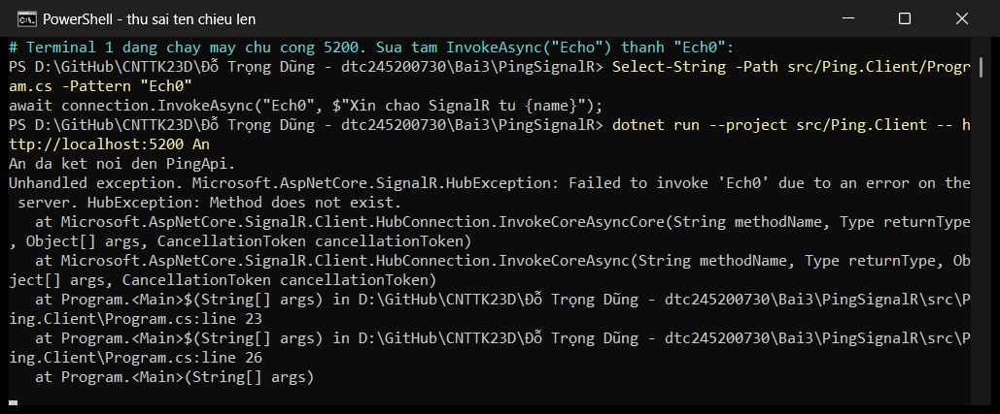

```text
An da ket noi den PingApi.
Unhandled exception. Microsoft.AspNetCore.SignalR.HubException: Failed to invoke 'Ech0' due to an error on the server.
HubException: Method does not exist.
```

Sai tên chiều lên (máy khách → hub) báo lỗi ngay, chương trình dừng nên dễ phát hiện. Sai tên chiều xuống (`On("EchoRespone")`) thì im lặng – xem thí nghiệm 3 ở bước 7.

### Bước 5: phát rộng (`Clients.All`) và nhóm (`Clients.Group`)


Hub có thêm `Broadcast`, `JoinGroup`, `SendToGroup`; máy khách thêm `On("BroadcastMessage")`, `On("GroupMessage")` (đăng ký TRƯỚC `StartAsync`) và 3 lời gọi sau `Echo`. Chạy 3 terminal: máy chủ → An → Bình.

Terminal 2 – An (chạy trước):

```text
> dotnet run --project src/Ping.Client -- http://localhost:5200 An
An da ket noi den PingApi. ConnectionId: 3K5dbW4P
[Echo] Echo: Xin chao SignalR tu An
[Group] 3K5dbW4P da tham gia nhom lop-hoc-01
[Group] Thong bao nhom tu An
Dang cho thong diep... Nhan Enter de thoat.
[Broadcast] Xin chao tat ca tu An
[Group] 4r41eqv1 da tham gia nhom lop-hoc-01
[Group] Thong bao nhom tu Binh
[Broadcast] Xin chao tat ca tu Binh
```

Terminal 3 – Bình (chạy sau):

```text
> dotnet run --project src/Ping.Client -- http://localhost:5200 Binh
Binh da ket noi den PingApi. ConnectionId: 4r41eqv1
[Echo] Echo: Xin chao SignalR tu Binh
[Group] 4r41eqv1 da tham gia nhom lop-hoc-01
[Group] Thong bao nhom tu Binh
Dang cho thong diep... Nhan Enter de thoat.
[Broadcast] Xin chao tat ca tu Binh
```

Thấy: cửa sổ An có `[Broadcast] Xin chao tat ca tu Binh` và `[Group] Thong bao nhom tu Binh` nhưng KHÔNG có `[Echo] ... tu Binh`. Bình không thấy tin An gửi trước khi Bình vào.
Giải thích:

| Phạm vi | Ai nhận | Trong ví dụ |
|---|---|---|
| `Clients.Caller` | chỉ kết nối vừa gọi hub | `Echo` → chỉ người gửi thấy `[Echo]` |
| `Clients.All` | mọi kết nối đang mở, kể cả người gửi | `Broadcast` → An và Bình cùng thấy |
| `Clients.Group(tên)` | các kết nối đã ở trong nhóm | `JoinGroup` / `SendToGroup` trong `lop-hoc-01` |

`Context.ConnectionId` là mã của kết nối đang gọi hub, đổi mỗi lần nối. `Groups.AddToGroupAsync` thêm kết nối vào nhóm, nhóm tự tạo khi cần. SignalR không lưu tin cũ nên Bình vào sau không nhận lại tin của An.

Thử thách 3 máy khách (An, Bình trong nhóm `lop-hoc-01`, Chi không ở nhóm nào):

| Lời gọi | An | Bình | Chi | Phạm vi |
|---|---|---|---|---|
| An gọi `Echo("hi")` | nhận | không | không | `Clients.Caller` |
| Chi gọi `SendToGroup("lop-hoc-01", "x")` | nhận | nhận | không | `Clients.Group` |
| Bình gọi `Broadcast("y")` | nhận | nhận | nhận | `Clients.All` |

Chi gửi được vào nhóm nhưng chính Chi không nhận vì không phải thành viên – hub ví dụ không kiểm tra quyền.

### Bước 6: vòng đời kết nối và tự kết nối lại


Hub ghi đè `OnConnectedAsync` / `OnDisconnectedAsync` (in `[Hub] + ...`, `[Hub] - ...` và gửi `SystemMessage` cho mọi người). Máy khách thêm `On("SystemMessage")` và 3 sự kiện `Reconnecting`, `Reconnected`, `Closed`.

Thí nghiệm: An đang chạy thì tắt máy chủ (Ctrl+C) rồi chạy lại ngay.

Terminal 2 – An (kết quả chạy thật):

```text
An da ket noi den PingApi. ConnectionId: EsRid0Eo
[System] Client EsRid0Eo da ket noi.
[Echo] Echo: Xin chao SignalR tu An
[Group] EsRid0Eo da tham gia nhom lop-hoc-01
[Group] Thong bao nhom tu An
Dang cho thong diep... Nhan Enter de thoat.
[Broadcast] Xin chao tat ca tu An
# (Terminal 1: Ctrl+C tắt máy chủ, rồi chạy lại)
[Lifecycle] Dang ket noi lai...
[Lifecycle] Da ket noi lai: UBx58szm
[System] Client UBx58szm da ket noi.
# (nhấn Enter để thoát)
[Lifecycle] Ket noi da dong.
```

Terminal 1 – máy chủ (lần chạy 1 rồi lần chạy 2):

```text
[Hub] + EsRid0Eo ket noi
# Ctrl+C, dotnet run lại
      Now listening on: http://localhost:5200
[Hub] + UBx58szm ket noi
[Hub] - UBx58szm ngat
```

Thấy: `[Lifecycle] Dang ket noi lai...` rồi `[Lifecycle] Da ket noi lai: UBx58szm` – ConnectionId khác ban đầu (`EsRid0Eo`).
Giải thích:

- `WithAutomaticReconnect()` mặc định thử lại sau 0 s, 2 s, 10 s, 30 s; hết 4 lần thì `Closed`. Ở đây máy chủ lên lại sau ~3 s nên nối lại được ở lần thử thứ 2–3.
- Nối lại = kết nối MỚI: ConnectionId đổi, máy chủ chạy lại `OnConnectedAsync`.
- Nhóm gắn với ConnectionId cũ nên bị mất; muốn ở lại nhóm phải gọi `JoinGroup` lại trong `Reconnected`.
- Tin gửi lúc đang rớt là mất hẳn – SignalR không lưu tin để gửi lại.
- `override` ghi đè hàm có sẵn của lớp `Hub`, nhớ gọi `base.` ở cuối.

### Bước 7: ba thí nghiệm lỗi (chạy thật rồi sửa lại cho đúng)

**Lỗi 1 – máy chủ chưa chạy** (chạy máy khách khi Terminal 1 đã tắt):


```text
Unhandled exception. System.Net.Http.HttpRequestException: No connection could be made because the target machine
actively refused it. (localhost:5200)
 ---> System.Net.Sockets.SocketException (10061): No connection could be made because the target machine actively refused it.
```

**Lỗi 2 – sai đường dẫn hub** (`WithUrl($"{serverUrl}/hub/ping")`, thiếu chữ `s`):

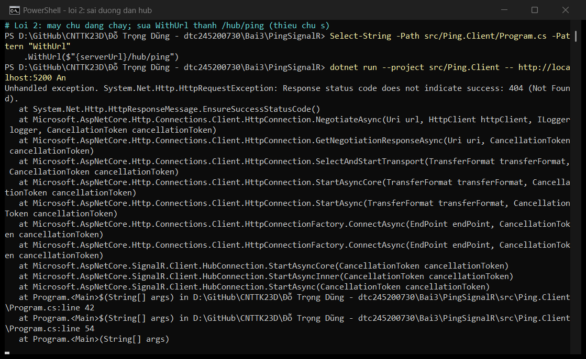

```text
Unhandled exception. System.Net.Http.HttpRequestException: Response status code does not indicate success: 404 (Not Found).
   at System.Net.Http.HttpResponseMessage.EnsureSuccessStatusCode()
   at Microsoft.AspNetCore.Http.Connections.Client.HttpConnection.NegotiateAsync(...)
```

**Lỗi 3 – sai tên thông điệp** (`On<string>("EchoRespone", ...)`):

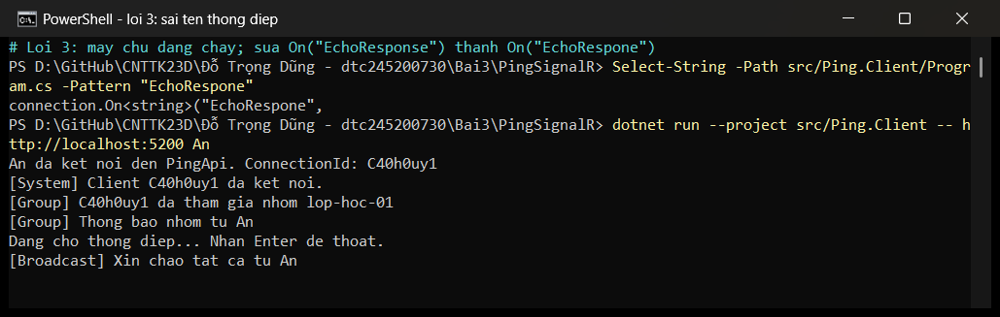

```text
An da ket noi den PingApi. ConnectionId: TZG_0VT3
[System] Client TZG_0VT3 da ket noi.
[Group] TZG_0VT3 da tham gia nhom lop-hoc-01
[Group] Thong bao nhom tu An
Dang cho thong diep... Nhan Enter de thoat.
[Broadcast] Xin chao tat ca tu An
[Lifecycle] Ket noi da dong.
```

(không có lỗi nào, chỉ là KHÔNG có dòng `[Echo]`)

| # | Thí nghiệm | Dự đoán | Kết quả thật | Giải thích |
|---|---|---|---|---|
| 1 | Máy chủ chưa chạy | `StartAsync` báo lỗi kết nối | `HttpRequestException`: actively refused (localhost:5200) | `StartAsync` ném lỗi ngay ở lần nối đầu; `WithAutomaticReconnect` chỉ cứu kết nối ĐÃ mở |
| 2 | `WithUrl` sai `/hub/ping` | lỗi 404 | `HttpRequestException ... 404 (Not Found)` tại `NegotiateAsync` | Lỗi xảy ra ở bước negotiate: đường dẫn phải khớp `MapHub("/hubs/ping")` |
| 3 | `On("EchoRespone")` | không in `[Echo]`, không báo lỗi | Đúng: không lỗi, không có dòng `[Echo]` | Sai tên chiều xuống thì im lặng – hub vẫn gửi `EchoResponse` nhưng không có hàm nào nghe tên đó. Không nhận được gì thì so tên hai phía trước tiên |
| 4 | `InvokeAsync("Ech0")` (bước 4) | lỗi | `HubException: Method does not exist` | Sai tên chiều lên báo lỗi ngay, dễ phát hiện |

**Tổng hợp PingSignalR** – bốn trụ cột: (1) `AddSignalR` + `MapHub` ở máy chủ; (2) phương thức hub gửi bằng `Clients.X.SendAsync`; (3) `HubConnectionBuilder` + `On` + `StartAsync` ở máy khách; (4) chọn đúng phạm vi người nhận (`Caller`, `All`, `Group`, `Client(id)`).

---

## Phần 2 – EduSubmit realtime (`RealtimeSubmissionSystem`)

Thiết kế kênh thời gian thực – trả lời 4 câu hỏi khung trước khi code:

| Câu hỏi | Trả lời | Thành code |
|---|---|---|
| 1. Sự kiện nào? | Trạng thái lượt nộp đổi: `received → processing → graded` | `UpdateStatusAsync(id, status, ...)` |
| 2. Gửi cho ai? | Chỉ máy khách đang theo dõi đúng lượt nộp đó | `Clients.Group("submission:{id}")` |
| 3. Gửi kèm gì? | Mã lượt nộp, trạng thái mới, thời điểm đổi (tối thiểu) | `record SubmissionStatusMessage(Guid SubmissionId, string Status, DateTimeOffset UpdatedAt)` |
| 4. Mất kết nối thì sao? | Gọi lại REST `GET /api/submissions/{id}` – REST là nguồn sự thật | `http.GetFromJsonAsync<SubmissionDto>(...)` |

### Bước 1: tạo solution mới với hai project, thêm gói cho máy khách

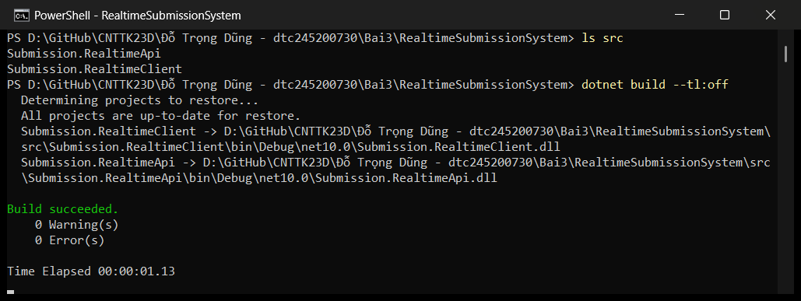

```powershell
mkdir RealtimeSubmissionSystem; cd RealtimeSubmissionSystem
dotnet new sln -n RealtimeSubmissionSystem
dotnet new web -n Submission.RealtimeApi -o src/Submission.RealtimeApi
dotnet new console -n Submission.RealtimeClient -o src/Submission.RealtimeClient
dotnet sln add src/Submission.RealtimeApi/Submission.RealtimeApi.csproj
dotnet sln add src/Submission.RealtimeClient/Submission.RealtimeClient.csproj
dotnet add src/Submission.RealtimeClient package Microsoft.AspNetCore.SignalR.Client --version 10.0.15
dotnet new gitignore
dotnet build
```

```text
Build succeeded.
    0 Warning(s)
    0 Error(s)
```

Thấy: build 0 lỗi. `Submission.RealtimeApi` = REST Bài 2 + hub (template web, cổng 5000 như Bài 2); `Submission.RealtimeClient` = `HttpClient` + `HubConnection` (template console + gói SignalR Client). Cùng khuôn 9 lệnh như PingSignalR, chỉ khác tên.

### Bước 2: dán REST của Bài 2, thêm `UpdatedAt` và khóa `submissionsLock`

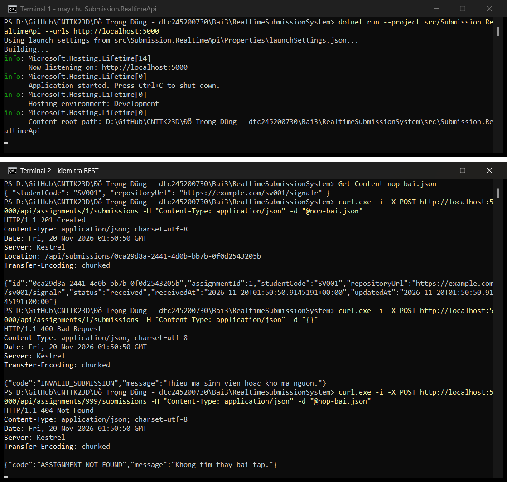

Giữ nguyên các endpoint Bài 2 (`GET /`, `GET /api/assignments`, `GET /api/assignments/{id}`, `POST /api/assignments/{id}/submissions`, `GET /api/submissions/{id}`, `ApiError`). Thay đổi:

- `SubmissionDto` thêm `UpdatedAt` – thời điểm đổi trạng thái gần nhất.
- Mọi đọc/ghi danh sách `submissions` đặt trong `lock (submissionsLock)` vì bước 4 sẽ có tác vụ nền sửa danh sách song song với request HTTP.

`nop-bai.json` chứa `studentCode` và `repositoryUrl` như Bài 2.

```text
> curl.exe -i -X POST http://localhost:5000/api/assignments/1/submissions -H "Content-Type: application/json" -d "@nop-bai.json"
HTTP/1.1 201 Created
Content-Type: application/json; charset=utf-8
Location: /api/submissions/06216bf6-5b37-4578-9142-e07746b41edc

{"id":"06216bf6-5b37-4578-9142-e07746b41edc","assignmentId":1,"studentCode":"SV001",
 "repositoryUrl":"https://example.com/sv001/signalr","status":"received",
 "receivedAt":"2026-11-20T01:30:32.7783915+00:00","updatedAt":"2026-11-20T01:30:32.7783915+00:00"}

> curl.exe -i -X POST http://localhost:5000/api/assignments/1/submissions -H "Content-Type: application/json" -d "{}"
HTTP/1.1 400 Bad Request

> curl.exe -X POST http://localhost:5000/api/assignments/999/submissions ...   → 404
```

Thấy: POST trả `201 Created`, body có `"status":"received"` và `"updatedAt"`. Thứ tự kiểm tra giữ như Bài 2: 404 (không có bài) → 400 CLOSED → 400 INVALID → 201.

### Bước 3: hub mỏng `SubmissionHub` đưa kết nối vào nhóm `submission:{id}`

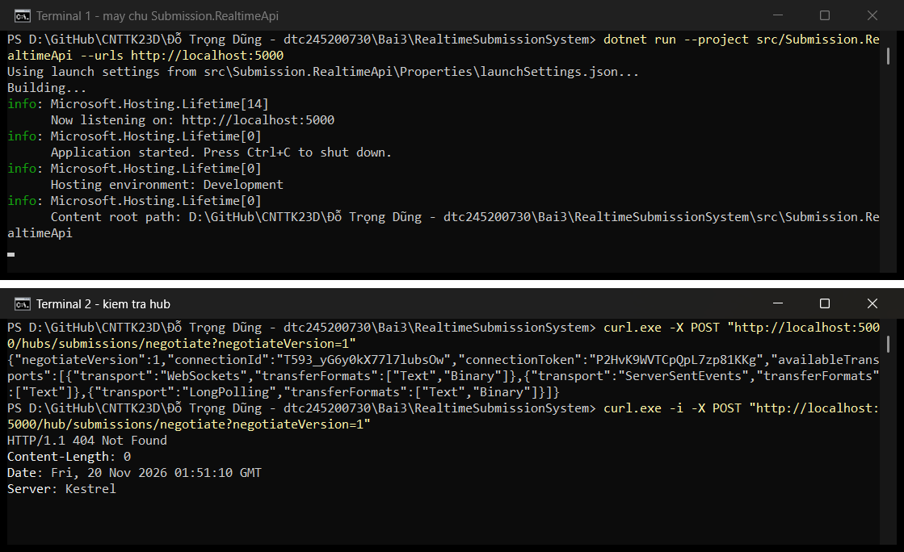

```csharp
builder.Services.AddSignalR();                              // trước builder.Build()
app.MapHub<SubmissionHub>("/hubs/submissions");             // trước app.Run()

sealed class SubmissionHub : Hub
{
    public async Task WatchSubmission(string submissionId)
        => await Groups.AddToGroupAsync(Context.ConnectionId, SubmissionGroups.ForSubmission(submissionId));
}

static class SubmissionGroups
{
    public static string ForSubmission(Guid id) => ForSubmission(id.ToString());
    public static string ForSubmission(string id) => $"submission:{id}";
}
```

```text
> curl.exe -X POST "http://localhost:5000/hubs/submissions/negotiate?negotiateVersion=1"
{"negotiateVersion":1,"connectionId":"Y4ah2yp_gbnR62068wmIeQ","connectionToken":"-J5QI2lN8j_rEKaK4jRzGw",
 "availableTransports":[{"transport":"WebSockets",...},{"transport":"ServerSentEvents",...},{"transport":"LongPolling",...}]}

> curl.exe -i -X POST "http://localhost:5000/hub/submissions/negotiate?negotiateVersion=1"
HTTP/1.1 404 Not Found
```

Thấy: negotiate ở `/hubs/submissions` trả `connectionId`; `/hub/submissions` trả 404.
Giải thích: hub chỉ làm MỘT việc – máy khách gọi `WatchSubmission(id)` sau khi có id từ POST, hub thêm kết nối vào nhóm `submission:{id}`. Nghiệp vụ (tạo, chấm bài) nằm ở REST và tác vụ nền. `SubmissionGroups` là chỗ duy nhất sinh tên nhóm để hai phía không lệch tên.

Vì sao nhóm theo lượt nộp thay vì `Clients.All` + máy khách tự lọc:

1. **Riêng tư** – chỉ đúng sinh viên theo dõi lượt nộp đó nhận tin; máy khách khác không thấy dữ liệu của người khác.
2. **Băng thông** – 100 SV, mỗi lượt đổi trạng thái 2 lần: gửi theo nhóm = 200 thông điệp; gửi tất cả = 100 × 100 × 2 = 20.000 thông điệp.

Nhóm do MÁY CHỦ quản lý, máy khách không tự lọc.

### Bước 4: `IHubContext` + mô phỏng chấm bài ở nền

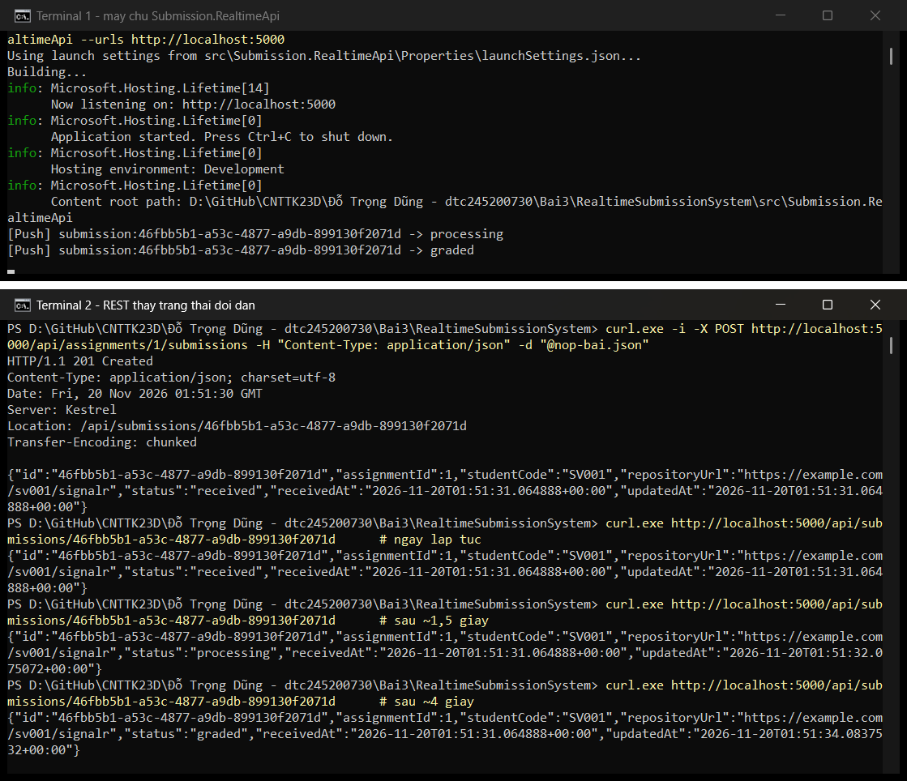

- Endpoint POST nhận thêm tham số `IHubContext<SubmissionHub> hubContext` (ASP.NET Core tự đưa vào qua DI), tạo lượt nộp `received` rồi gọi `_ = SimulateGradingAsync(...)` **không await** → trả 201 ngay.
- `SimulateGradingAsync`: `Task.Delay(1s)` → `processing`, `Task.Delay(2s)` → `graded`.
- `UpdateStatusAsync`: (1) cập nhật danh sách trong `lock` (record bất biến nên dùng `with { Status, UpdatedAt }`) → (2) tạo `SubmissionStatusMessage(Id, Status, UpdatedAt)` chỉ 3 trường → (3) `hub.Clients.Group("submission:{id}").SendAsync("SubmissionStatusChanged", msg)`. Lưu trước, đẩy sau: ai nhận tin rồi đọc REST đều thấy đúng.

Kiểm tra chưa cần máy khách – REST đã thấy trạng thái đổi dần:

```text
> curl.exe -i -X POST http://localhost:5000/api/assignments/1/submissions -H "Content-Type: application/json" -d "@nop-bai.json"
HTTP/1.1 201 Created
Location: /api/submissions/9efc75da-7a5e-47aa-8cad-5b3d10897355
{"id":"9efc75da-...","assignmentId":1,"studentCode":"SV001",...,"status":"received","updatedAt":"2026-11-20T01:31:35.5314836+00:00"}

> curl.exe http://localhost:5000/api/submissions/9efc75da-7a5e-47aa-8cad-5b3d10897355     # ngay lập tức
{...,"status":"received","updatedAt":"2026-11-20T01:31:35.5314836+00:00"}

> curl.exe http://localhost:5000/api/submissions/9efc75da-7a5e-47aa-8cad-5b3d10897355     # sau ~1,5 giây
{...,"status":"processing","updatedAt":"2026-11-20T01:31:36.5390438+00:00"}

> curl.exe http://localhost:5000/api/submissions/9efc75da-7a5e-47aa-8cad-5b3d10897355     # sau ~4 giây
{...,"status":"graded","updatedAt":"2026-11-20T01:31:38.5494168+00:00"}
```

Terminal 1 – máy chủ:

```text
[Push] submission:9efc75da-7a5e-47aa-8cad-5b3d10897355 -> processing
[Push] submission:9efc75da-7a5e-47aa-8cad-5b3d10897355 -> graded
```

Thấy: ba lần GET đúng thứ tự `received → processing → graded`, `updatedAt` tăng dần (cách ~1 s rồi ~2 s).
Giải thích: không truyền được đối tượng hub vào tác vụ nền vì hub chỉ sống trong MỘT lời gọi; ngoài hub phải dùng `IHubContext` (trong hub: `Clients`, ngoài hub: `hubContext.Clients`, cùng phạm vi All/Group…). REST luôn biết trạng thái đúng; SignalR chỉ giúp máy khách biết SỚM hơn mà không phải hỏi. Hệ thật sẽ thay `Task.Delay` bằng hàng đợi + worker (Bài 6), cách đẩy về giữ nguyên.

### Bước 5: máy khách mở hai kênh và gắn "chuông" chờ `graded`

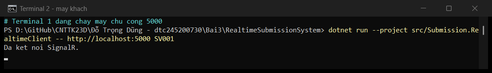

```csharp
using var http = new HttpClient { BaseAddress = new Uri(apiBaseUrl) };            // Kênh 1: REST
await using var connection = new HubConnectionBuilder()                           // Kênh 2: SignalR
    .WithUrl($"{apiBaseUrl}/hubs/submissions").WithAutomaticReconnect().Build();

var gradedNotification = new TaskCompletionSource();                              // "cái chuông"
connection.On<SubmissionStatusMessage>("SubmissionStatusChanged", m => {
    Console.WriteLine($"Thong bao SignalR: {m.SubmissionId} -> {m.Status} luc {m.UpdatedAt.ToLocalTime():HH:mm:ss}");
    if (m.Status == "graded") gradedNotification.TrySetResult();
});
await connection.StartAsync();
Console.WriteLine("Da ket noi SignalR.");
```

```text
> dotnet run --project src/Submission.RealtimeClient -- http://localhost:5000 SV001
Da ket noi SignalR.
```

Giải thích: một URL gốc `http://localhost:5000` dùng cho cả REST (`BaseAddress`) và hub (`/hubs/submissions`). `On<SubmissionStatusMessage>` để SignalR tự chuyển JSON thành record – record khai báo giống máy chủ ở cuối tệp (`AssignmentDto`, `CreateSubmissionRequest`, `SubmissionDto`, `SubmissionStatusMessage`, `ApiError`). `TaskCompletionSource` là một Task "bấm tay": hoàn tất khi gọi `TrySetResult`, dùng để chờ một sự kiện.

### Bước 6: tạo lượt nộp bằng REST, theo dõi bằng SignalR, chốt lại bằng REST

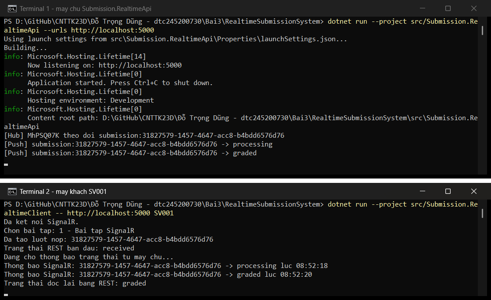

Trình tự trong máy khách: (1) `GET /api/assignments` → (2) `POST .../submissions` (kiểm tra 201 trước khi đọc body, lỗi thì in `ApiError`) → (3) `InvokeAsync("WatchSubmission", created.Id)` → (4) `Task.WhenAny(chuông graded, Task.Delay(10s))` → (5) `GET /api/submissions/{id}`.

Terminal 2 – máy khách (kết quả máy khách 8 dòng):

```text
> dotnet run --project src/Submission.RealtimeClient -- http://localhost:5000 SV001
Da ket noi SignalR.
Chon bai tap: 1 - Bai tap SignalR
Da tao luot nop: bb79ce4e-315c-4ac1-8062-e2d4661d0e86
Trang thai REST ban dau: received
Dang cho thong bao trang thai tu may chu...
Thong bao SignalR: bb79ce4e-315c-4ac1-8062-e2d4661d0e86 -> processing luc 08:32:43
Thong bao SignalR: bb79ce4e-315c-4ac1-8062-e2d4661d0e86 -> graded luc 08:32:45
Trang thai doc lai bang REST: graded
```

Terminal 1 – máy chủ:

```text
Now listening on: http://localhost:5000
[Hub] GXrT5806 theo doi submission:bb79ce4e-315c-4ac1-8062-e2d4661d0e86
[Push] submission:bb79ce4e-315c-4ac1-8062-e2d4661d0e86 -> processing
[Push] submission:bb79ce4e-315c-4ac1-8062-e2d4661d0e86 -> graded
```

Thấy: 2 dòng `Thong bao SignalR` cách nhau 2 giây – hai cập nhật đến từ máy chủ mà máy khách không hề hỏi; máy khách tự thoát (mã thoát 0) ngay sau khi đọc lại `graded`, tổng ~4 giây.
Giải thích: dòng "Chon bai tap / Da tao luot nop / Trang thai REST ban dau" là REST; hai dòng "Thong bao SignalR" là push qua nhóm `submission:{id}`; dòng cuối quay về REST vì **REST là nguồn sự thật** – tin đẩy có thể lỡ, trạng thái cuối luôn đọc lại bằng GET.

Trật tự đúng: **nghe (`On`) → nối (`StartAsync`) → tạo (`POST`) → theo dõi (`Watch(id)`) → đọc lại (`GET`)**. Không nhận được thông báo thì kiểm tra lần lượt: 1. cổng/URL, 2. đường dẫn hub khớp `MapHub`, 3. `WatchSubmission` gọi SAU POST với đúng `created.Id`, 4. tên `"SubmissionStatusChanged"` giống nhau ở `SendAsync` và `On`.

### Bước 7: năm thí nghiệm phân tán (ghi dự đoán trước, chạy thật sau)

Mỗi thí nghiệm sửa tạm máy khách, chạy, ghi kết quả rồi hoàn nguyên code.

**TN1 – hai máy khách SV001 và SV002 chạy cùng lúc**

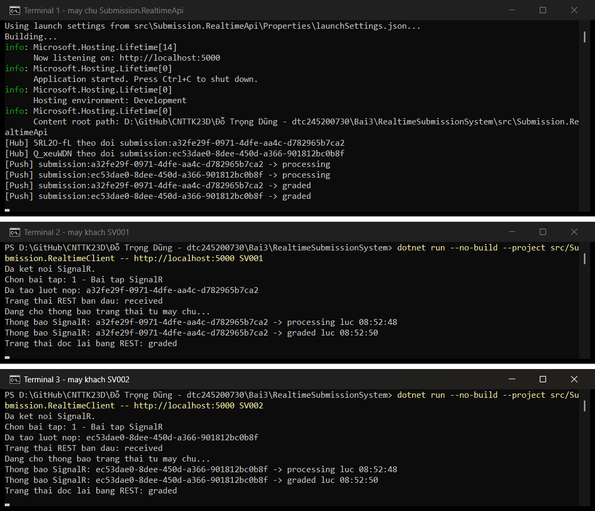

```text
--- SV001
Da tao luot nop: 312070eb-6c1d-480a-b590-1ddf0b7ebc0e
Thong bao SignalR: 312070eb-6c1d-480a-b590-1ddf0b7ebc0e -> processing luc 08:33:15
Thong bao SignalR: 312070eb-6c1d-480a-b590-1ddf0b7ebc0e -> graded luc 08:33:17
Trang thai doc lai bang REST: graded
--- SV002
Da tao luot nop: fdbc21a7-bd88-4124-9cf8-f66589418c5c
Thong bao SignalR: fdbc21a7-bd88-4124-9cf8-f66589418c5c -> processing luc 08:33:15
Thong bao SignalR: fdbc21a7-bd88-4124-9cf8-f66589418c5c -> graded luc 08:33:17
Trang thai doc lai bang REST: graded
--- máy chủ
[Hub] -BaTpbpn theo doi submission:312070eb-6c1d-480a-b590-1ddf0b7ebc0e
[Hub] 7ES2fQp9 theo doi submission:fdbc21a7-bd88-4124-9cf8-f66589418c5c
[Push] submission:312070eb-... -> processing
[Push] submission:fdbc21a7-... -> processing
[Push] submission:fdbc21a7-... -> graded
[Push] submission:312070eb-... -> graded
```

**TN2 – chạy máy khách khi máy chủ chưa chạy**

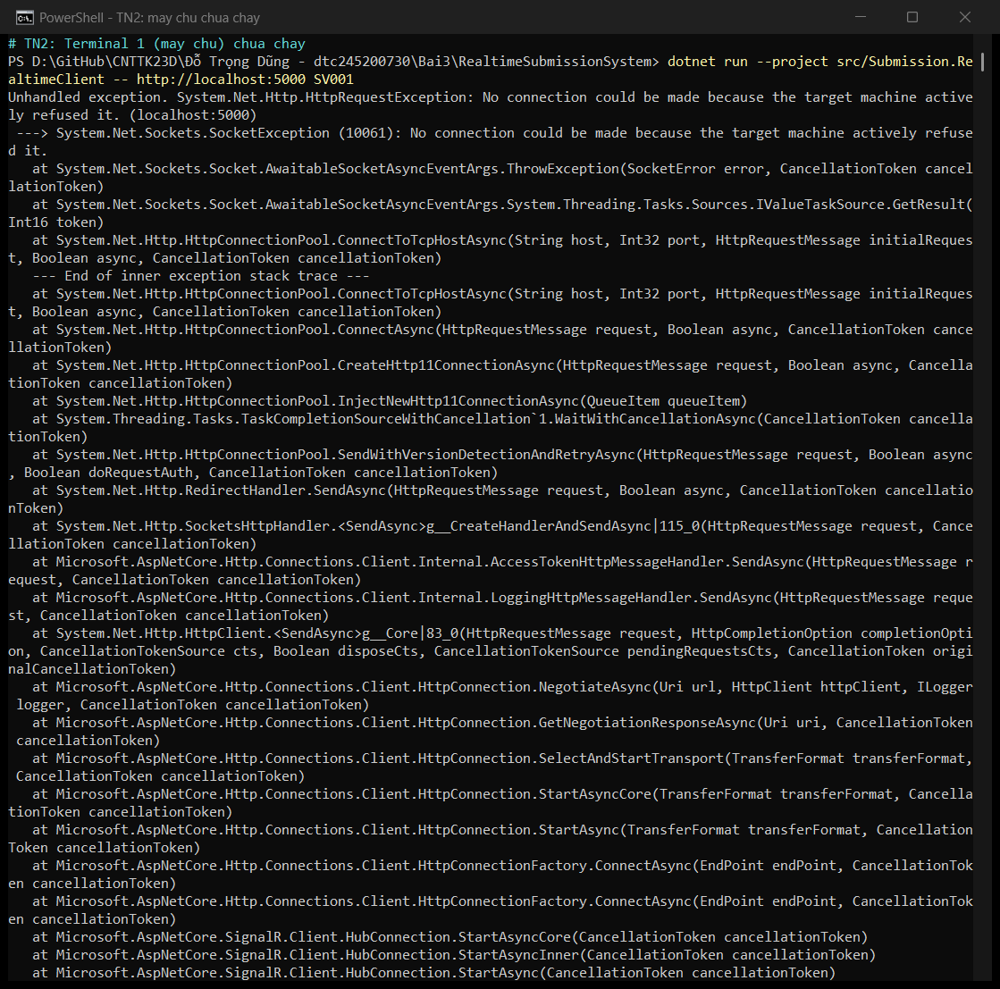

```text
Unhandled exception. System.Net.Http.HttpRequestException: No connection could be made because the target machine
actively refused it. (localhost:5000)
```

**TN3 – sửa `WithUrl` thành `/hub/submissions`**

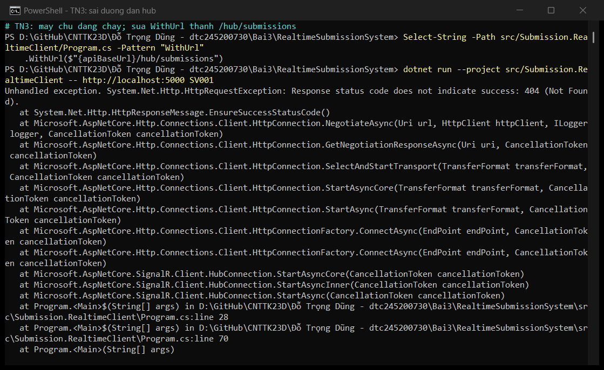

```text
Unhandled exception. System.Net.Http.HttpRequestException: Response status code does not indicate success: 404 (Not Found).
   at Microsoft.AspNetCore.Http.Connections.Client.HttpConnection.NegotiateAsync(...)
```

**TN4 – sửa `On("SubmissionStatusChanged")` thành `On("SubmissionStatusChange")`** (chạy mất 10,9 giây)

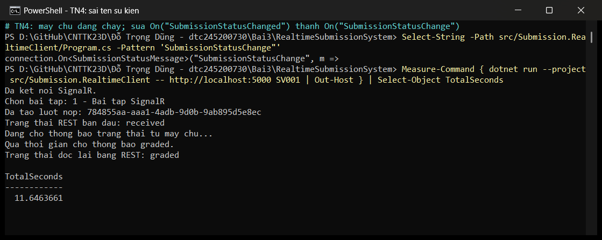

```text
Da ket noi SignalR.
Chon bai tap: 1 - Bai tap SignalR
Da tao luot nop: da6be1b8-987c-493b-9f35-2a66f3dfd9ed
Trang thai REST ban dau: received
Dang cho thong bao trang thai tu may chu...
Qua thoi gian cho thong bao graded.
Trang thai doc lai bang REST: graded
```

**TN5 – chờ 4 giây rồi mới gọi `WatchSubmission`** (chạy mất 14,9 giây)

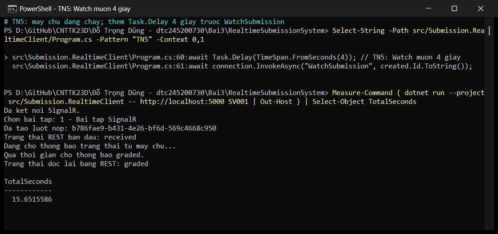

```text
Da ket noi SignalR.
Chon bai tap: 1 - Bai tap SignalR
Da tao luot nop: f99a6b6b-20ed-49f5-9107-4723abc667ed
Trang thai REST ban dau: received
Dang cho thong bao trang thai tu may chu...
Qua thoi gian cho thong bao graded.
Trang thai doc lai bang REST: graded
```

| # | Thí nghiệm | Dự đoán | Kết quả thật | Giải thích |
|---|---|---|---|---|
| 1 | Hai máy khách SV001, SV002 cùng lúc | Mỗi bên chỉ thấy lượt nộp của mình | Đúng: SV001 chỉ nhận tin `312070eb`, SV002 chỉ nhận `fdbc21a7` | Nhóm `submission:{id}` tách người nhận; máy chủ gửi theo nhóm nên không trộn tin, không lộ dữ liệu |
| 2 | Máy chủ chưa chạy | Lỗi kết nối ngay | `HttpRequestException: ... actively refused (localhost:5000)` | `StartAsync` ném lỗi ở lần nối đầu, không tự thử lại; `WithAutomaticReconnect` chỉ áp dụng cho kết nối đã mở |
| 3 | `WithUrl` sai `/hub/submissions` | Lỗi 404 | `HttpRequestException ... 404 (Not Found)` tại `NegotiateAsync` | Lỗi xảy ra ở bước negotiate; đường dẫn phải khớp `MapHub("/hubs/submissions")` |
| 4 | Sai tên `On("SubmissionStatusChange")` | Không lỗi, không có dòng "Thong bao SignalR" | Đúng: không lỗi; sau 10 giây in `Qua thoi gian cho thong bao graded.`; REST vẫn đọc ra `graded` | Sai tên chiều xuống thì im lặng – máy chủ vẫn gửi nhưng không hàm nào nghe. Đồng hồ 10 giây + REST cứu được kết quả |
| 5 | Chờ 4 giây rồi mới `WatchSubmission` | Lỡ hết tin vì bài đã chấm xong trước khi vào nhóm | Đúng: không nhận tin nào, hết 10 giây chờ; REST đọc lại: `graded` | Vào nhóm muộn là lỡ tin (SignalR không lưu tin cũ). Thiết kế đúng = push để nhanh + REST để chắc |

Bài học: thông điệp thời gian thực có thể bị lỡ (sai tên, vào nhóm muộn, đứt mạng), nên luôn chốt trạng thái bằng `GET /api/submissions/{id}`.

### Bước 8: `requests.http` gom các ca REST và bước bắt tay của hub

`RealtimeSubmissionSystem/requests.http` có 14 ca (đủ 9 ca của bài giảng + ca chi tiết bài tập, bài tập đã đóng, bài tập 2 và negotiate của PingSignalR). Để có bằng chứng chạy thật, `kiem-tra-requests.ps1` gửi lại đúng các ca đó bằng `curl.exe` và in mã trạng thái thực tế (ca 5 đọc lại 2 lần: ngay lập tức và sau 5 giây theo `Location`).

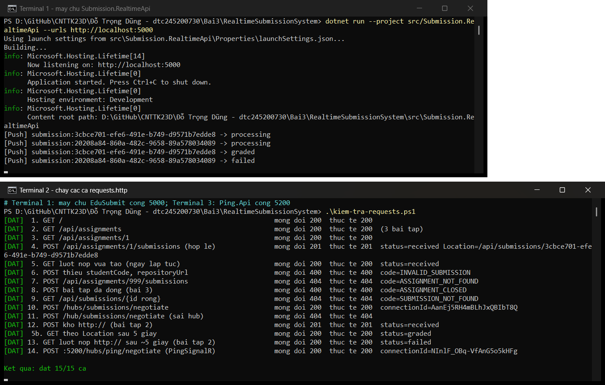

| # | Ca | Mong đợi | Thực tế |
|---|---|---|---|
| 1 | `GET /` | 200 | 200 |
| 2 | `GET /api/assignments` | 200 | 200 (3 bài tập) |
| 3 | `GET /api/assignments/1` | 200 | 200 |
| 4 | `POST /api/assignments/1/submissions` hợp lệ | 201 + Location, `received` | 201, `received`, có Location |
| 5 | `GET /api/submissions/{id}` (ngay / sau 5 giây) | 200 | 200 `received` → 200 `graded` |
| 6 | `POST` thiếu `studentCode`, `repositoryUrl` | 400 | 400 `INVALID_SUBMISSION` |
| 7 | `POST /api/assignments/999/submissions` | 404 | 404 `ASSIGNMENT_NOT_FOUND` |
| 8 | `POST` bài tập đã đóng (bài 3) | 400 | 400 `ASSIGNMENT_CLOSED` |
| 9 | `GET /api/submissions/{id rỗng}` | 404 | 404 `SUBMISSION_NOT_FOUND` |
| 10 | `POST /hubs/submissions/negotiate` | 200 + connectionId | 200 + connectionId |
| 11 | `POST /hub/submissions/negotiate` (sai hub) | 404 | 404 |
| 12 | `POST` kho `http://` (bài tập 2) | 201 | 201 |
| 13 | `GET` lượt nộp `http://` sau ~5 giây | 200 `failed` | 200 `failed` |
| 14 | `POST :5200/hubs/ping/negotiate` | 200 + connectionId | 200 + connectionId |

Kết quả: **đạt 15/15 lần gọi**. Bảng này bao trùm cả 7 yêu cầu kiểm tra của thang điểm (GET danh sách 200; POST 201 + Location; POST thiếu dữ liệu 400; POST bài 999 404; negotiate `/hubs/submissions` 200; GET theo Location sau 5 giây 200 `graded`; negotiate `:5200/hubs/ping` 200).

### Vận dụng: bài tập 2 và bài tập 3

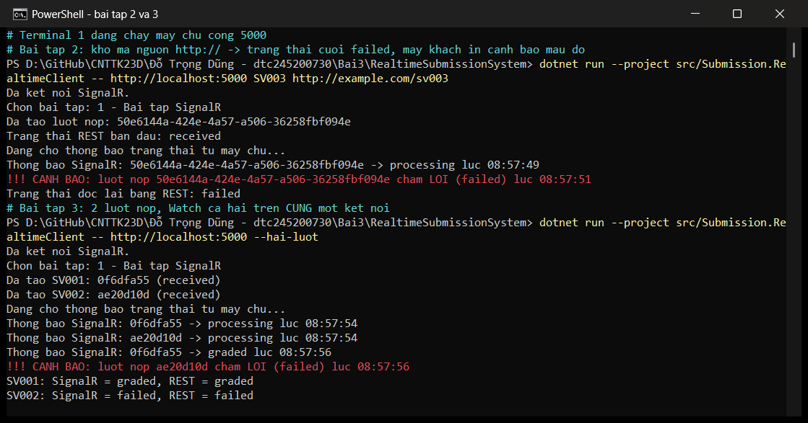

**Bài tập 2 – trạng thái `failed`.**

- Máy chủ (`SimulateGradingAsync`): `repositoryUrl` không bắt đầu bằng `https://` thì trạng thái cuối là `failed` thay vì `graded`.
- Máy khách: nhận `failed` thì in `!!! CANH BAO: ... cham LOI (failed)` màu đỏ; chuông cũng reo với `failed` (đều là trạng thái cuối) nên không phải chờ hết 10 giây.
- Câu hỏi khung bị ảnh hưởng: **câu 1** (sự kiện có thêm nhánh `processing → failed`) và **câu 3** (giá trị `Status` trong thông điệp có thêm `failed`). Câu 2 (nhóm) và câu 4 (đọc lại bằng REST) giữ nguyên.

```text
> dotnet run --project src/Submission.RealtimeClient -- http://localhost:5000 SV003 http://example.com/sv003
Da ket noi SignalR.
Chon bai tap: 1 - Bai tap SignalR
Da tao luot nop: e1930c8c-cd4d-41aa-9494-4e89ece99406
Trang thai REST ban dau: received
Dang cho thong bao trang thai tu may chu...
Thong bao SignalR: e1930c8c-cd4d-41aa-9494-4e89ece99406 -> processing luc 08:55:33
!!! CANH BAO: luot nop e1930c8c-cd4d-41aa-9494-4e89ece99406 cham LOI (failed) luc 08:55:35
Trang thai doc lai bang REST: failed
```

**Bài tập 3 – theo dõi hai lượt nộp trên cùng một kết nối** (`--hai-luot`).

- Tạo 2 lượt nộp (SV001 kho `https://`, SV002 kho `http://`), gọi `WatchSubmission` cho cả hai trên CÙNG một `HubConnection`.
- Mỗi lượt nộp một `TaskCompletionSource<string>` trong `ConcurrentDictionary<Guid, ...>`; hàm `On` tra theo `SubmissionId` để reo đúng chuông. Chờ `Task.WhenAll` (tối đa 10 giây), rồi đọc lại REST từng lượt.

```text
> dotnet run --project src/Submission.RealtimeClient -- http://localhost:5000 --hai-luot
Da ket noi SignalR.
Chon bai tap: 1 - Bai tap SignalR
Da tao SV001: 47338e44 (received)
Da tao SV002: 4aadff59 (received)
Dang cho thong bao trang thai tu may chu...
Thong bao SignalR: 47338e44 -> processing luc 08:55:37
Thong bao SignalR: 4aadff59 -> processing luc 08:55:37
Thong bao SignalR: 47338e44 -> graded luc 08:55:39
!!! CANH BAO: luot nop 4aadff59 cham LOI (failed) luc 08:55:39
SV001: SignalR = graded, REST = graded
SV002: SignalR = failed, REST = failed
```

Chứng minh không trộn lẫn: mỗi thông điệp mang `SubmissionId` riêng; trạng thái cuối nhận qua SignalR của từng lượt nộp khớp đúng trạng thái đọc lại bằng REST (`graded` = `graded`, `failed` = `failed`).

**Bài tập 4 – chạy máy khách khi API tắt:** chính là TN2 ở bước 7: `HttpRequestException ... actively refused (localhost:5000)` ngay ở `StartAsync`. Lần nối đầu không tự thử lại; `WithAutomaticReconnect` chỉ cứu kết nối đã mở. Muốn chịu được API khởi động muộn thì phải tự viết vòng lặp thử lại quanh `StartAsync` (ví dụ thử lại sau 2, 5, 10 giây).

---

## Trả lời 3 câu hỏi đầu giờ

1. **Máy chủ có thể chủ động báo cho máy khách mà không cần máy khách hỏi không?**
   Có, nếu máy khách mở sẵn một kết nối lâu dài. Với HTTP thường chỉ máy khách mở lời; SignalR giữ một kết nối WebSocket (dự phòng SSE, Long Polling) để máy chủ gửi bất kỳ lúc nào bằng `Clients.Group(...).SendAsync(...)`; khi gửi từ bên ngoài hub (tác vụ chấm nền) thì dùng `IHubContext`. Ở bước 6, máy khách nhận `processing`, `graded` mà không gửi thêm yêu cầu nào.

2. **Đã có REST rồi, vì sao cần thêm SignalR? Hai thứ chia việc thế nào?**
   REST tạo và đọc tài nguyên với mã trạng thái rõ ràng (POST 201/400/404, GET 200/404) và là nguồn sự thật. SignalR chỉ đẩy các THAY ĐỔI phát sinh sau yêu cầu ban đầu tới đúng nhóm `submission:{id}`, thay cho polling tốn kém (100 SV hỏi 2 giây/lần = 3.000 yêu cầu/phút, chỉ ~7% có ích; push = 200 thông báo, 100% có ích). SignalR không thay thế REST – tạo lượt nộp vẫn bằng POST.

3. **Nếu đứt mạng đúng lúc máy chủ báo "đã chấm xong" thì sao?**
   Tin đó mất – SignalR không lưu tin để gửi lại. `WithAutomaticReconnect` nối lại với ConnectionId MỚI nên nhóm cũ cũng mất (bước 6 PingSignalR). Máy khách phải gọi lại `WatchSubmission(id)` trong `Reconnected` và gọi `GET /api/submissions/{id}` để lấy trạng thái cuối. Thí nghiệm TN4, TN5 cho thấy dù lỡ tin, REST vẫn đọc ra `graded`. **Push để nhanh, REST để chắc.**

## Câu hỏi ôn tập (giáo trình chương 3)

| Câu hỏi | Trả lời ngắn |
|---|---|
| Polling khác push ở số yêu cầu và độ trễ? | Polling: máy khách hỏi theo chu kỳ, phần lớn yêu cầu thừa, trễ tới 1 chu kỳ. Push: máy chủ gửi đúng lúc có sự kiện, không thừa, gần như tức thì |
| Phân biệt 3 MEP | Yêu cầu–phản hồi: máy khách khởi tạo, 1 yêu cầu, 1 phản hồi. Đẩy: máy chủ khởi tạo khi có sự kiện, từng thông điệp lẻ. Truyền luồng: một/hai phía, chuỗi nhiều thông điệp liên tục |
| WebSocket, SignalR: giao thức hay thư viện? | WebSocket là GIAO THỨC (kênh hai chiều sau bắt tay HTTP `101 Switching Protocols`). SignalR là THƯ VIỆN cấp cao của ASP.NET Core: hub, nhóm, kết nối lại, chọn truyền tải |
| SignalR có những truyền tải dự phòng nào? | WebSockets (ưu tiên 1) → Server-Sent Events (2) → Long Polling (3); thấy trong `availableTransports` của negotiate |
| Vì sao nhóm `submission:{id}` thay vì gửi tất cả? | Riêng tư (không lộ trạng thái bài người khác) và băng thông (200 thay vì 20.000 thông điệp) |
| `IHubContext` cho phép làm gì? | Gửi thông điệp từ BÊN NGOÀI hub (endpoint, tác vụ nền) với cùng phạm vi `All/Group/Client` |
| `On<T>` dùng để làm gì? Bỏ đi thì sao? | Đăng ký hàm xử lý theo TÊN thông điệp và tự chuyển JSON thành `T`. Bỏ (hoặc sai tên) thì thông điệp đến nhưng không ai xử lý – im lặng, không lỗi (TN4) |
| REST làm gì, SignalR làm gì? Vì sao không dùng SignalR để tạo lượt nộp? | REST tạo/đọc tài nguyên, có mã trạng thái, URI, Location, dễ test bằng curl/requests.http, là nguồn sự thật. SignalR chỉ báo thay đổi; tin có thể lỡ nên không dùng làm kênh tạo dữ liệu |
| `WithAutomaticReconnect` có tác dụng gì? | Tự nối lại kết nối đã mở khi rớt, thử sau 0, 2, 10, 30 giây; nối lại có ConnectionId mới; không áp dụng cho lần `StartAsync` đầu |
| Mất kết nối đúng lúc báo graded thì làm gì? | Trong `Reconnected` gọi lại `WatchSubmission(id)` và `GET /api/submissions/{id}` để chốt trạng thái |

**Thảo luận.**

- *Hàng trăm SV cùng theo dõi:* nhóm theo id tiết kiệm hơn hẳn – mỗi thay đổi chỉ gửi tới đúng kết nối đang theo dõi thay vì N kết nối rồi tự lọc, và không lộ dữ liệu.
- *Hai tình huống polling hợp lý hơn SignalR:* dữ liệu ít đổi và chấp nhận trễ vài chục giây (bảng điểm cập nhật mỗi giờ, trạng thái build đêm); hoặc mạng/proxy chặn kết nối lâu dài, máy khách chỉ cần kiểm tra một lần (script, cron).
- *Chạy nhiều bản sao API (scale-out):* nhóm nằm trong bộ nhớ từng máy chủ nên tác vụ chấm ở bản A gửi `Group(...)` thì máy khách đang nối với bản B không nhận được. Sửa: dùng backplane chung (Redis backplane hoặc Azure SignalR Service) và sticky session cho negotiate/transport.

## Danh sách kiểm tra trước khi mở PR

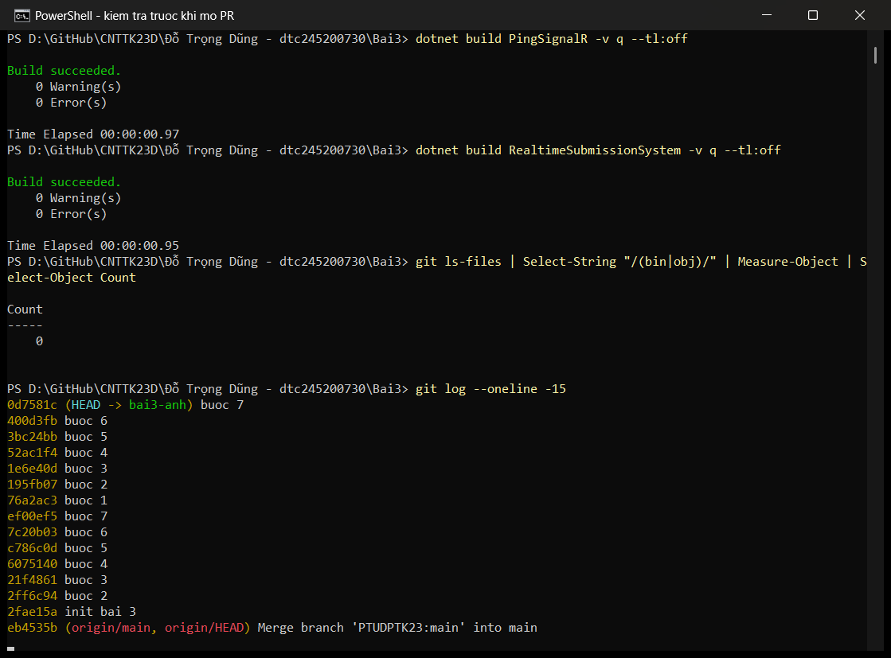

| Yêu cầu | Đạt? |
|---|---|
| `dotnet build` cả 2 solution: 0 Error(s) (4 project) | Đạt |
| Không commit `bin/`, `obj/` (mỗi solution có `.gitignore`; `git ls-files` không có bin/obj) | Đạt |
| `requests.http` đủ 9 ca trở lên (14 ca, có 200, 201, 400, 404, negotiate) | Đạt |
| README: kết quả máy khách 8 dòng (bước 6) | Đạt |
| README: 5 thí nghiệm (dự đoán + kết quả thật + giải thích) – bước 7 | Đạt |
| README: trả lời 3 câu hỏi đầu giờ | Đạt |
| Mỗi bước ≥ 1 commit, mỗi bước có ảnh trong `anh/` | Đạt |
| Máy khách EduSubmit tự thoát sau khi nhận graded; cổng cố định 5000 và 5200 qua `--urls` | Đạt |
| PR tiêu đề `Bai3 - dtc245200730 - Đỗ Trọng Dũng`, chỉ sửa thư mục của mình | khi mở PR |
