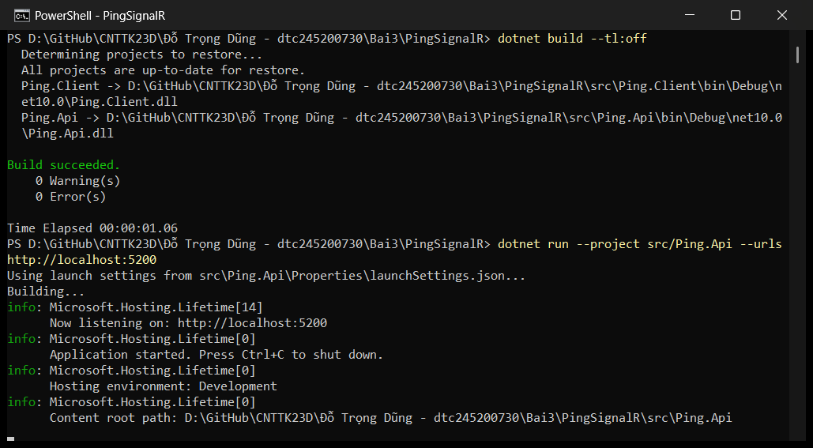

# Bài 3 – Giao tiếp thời gian thực với SignalR

Sinh viên: **Đỗ Trọng Dũng – dtc245200730**

Thư mục `Bai3` gồm hai solution:

| Solution | Project | Cổng | Vai trò |
|---|---|---|---|
| `PingSignalR` | `Ping.Api`, `Ping.Client` | 5200 | Ví dụ cơ bản: hub `/hubs/ping`, Echo / Broadcast / Group / vòng đời kết nối |
| `RealtimeSubmissionSystem` | `Submission.RealtimeApi`, `Submission.RealtimeClient` | 5000 | EduSubmit realtime: REST của Bài 2 + hub `/hubs/submissions` đẩy `processing`, `graded` |

---

## Phần 1 – PingSignalR

### Bước 1: tạo solution, 2 project, thêm gói SignalR Client


```powershell
mkdir PingSignalR; cd PingSignalR
dotnet new sln -n PingSignalR
dotnet new web -n Ping.Api -o src/Ping.Api
dotnet new console -n Ping.Client -o src/Ping.Client
dotnet sln add src/Ping.Api/Ping.Api.csproj
dotnet sln add src/Ping.Client/Ping.Client.csproj
dotnet add src/Ping.Client package Microsoft.AspNetCore.SignalR.Client --version 10.0.15
dotnet new gitignore
dotnet build
```

```text
Build succeeded.
    0 Warning(s)
    0 Error(s)
```

Thấy: build 2 project không lỗi. Giải thích: máy chủ dùng `Microsoft.AspNetCore.App` đã có sẵn SignalR, chỉ máy khách console cần thêm gói `Microsoft.AspNetCore.SignalR.Client` (cố định 10.0.15 để tránh cảnh báo bảo mật NU1903 của 10.0.0).

### Bước 2: máy chủ `AddSignalR` + `MapHub`, kiểm tra negotiate bằng curl


Terminal 1 – máy chủ:

```text
> dotnet run --project src/Ping.Api --urls http://localhost:5200
info: Microsoft.Hosting.Lifetime[14]
      Now listening on: http://localhost:5200
```

Terminal 2 – ba lệnh kiểm tra:

```text
> curl.exe http://localhost:5200/
{"service":"PingApi","status":"running"}

> curl.exe -X POST "http://localhost:5200/hubs/ping/negotiate?negotiateVersion=1"
{"negotiateVersion":1,"connectionId":"L1IIX_16Z25tC-a3QluWXw","connectionToken":"kF3ooiB7rHwyM4GEsY58ug",
 "availableTransports":[{"transport":"WebSockets","transferFormats":["Text","Binary"]},
                        {"transport":"ServerSentEvents","transferFormats":["Text"]},
                        {"transport":"LongPolling","transferFormats":["Text","Binary"]}]}

> curl.exe -i http://localhost:5200/hubs/ping
HTTP/1.1 400 Bad Request
Connection ID required
```

Thấy: negotiate trả `connectionId` và đủ 3 cơ chế truyền tải `WebSockets`, `ServerSentEvents`, `LongPolling`.
Giải thích: `AddSignalR()` đăng ký dịch vụ lõi (quản lý kết nối, nhóm, JSON hub protocol), `MapHub<PingHub>("/hubs/ping")` mở điểm cuối hub. Bước negotiate là bắt tay đầu tiên: máy chủ cấp mã kết nối và báo các cách truyền tải theo thứ tự ưu tiên. Gọi thẳng `GET /hubs/ping` bị 400 vì hub không trả lời như REST, phải có ConnectionId. Endpoint REST `GET /` vẫn chạy song song với hub.

### Bước 3: phương thức hub `Echo` trả lời riêng người gọi



```csharp
sealed class PingHub : Hub
{
    public async Task Echo(string message)
    {
        await Clients.Caller.SendAsync("EchoResponse", $"Echo: {message}");
    }
}
```

```text
> dotnet build
    0 Warning(s)
    0 Error(s)
> dotnet run --project src/Ping.Api --urls http://localhost:5200
      Now listening on: http://localhost:5200
```

Giải thích: mỗi phương thức `public` của hub là một "điểm cuối thời gian thực" mà máy khách gọi bằng `InvokeAsync("Echo", ...)`. Mẫu câu gửi `Clients.Caller.SendAsync("EchoResponse", dữ liệu)` = tập máy khách → ai nhận (`Caller` = chỉ kết nối vừa gọi) → gửi đi → TÊN thông điệp → nội dung. Hub chưa test được bằng curl vì cần máy khách SignalR, bước 4 viết máy khách.
